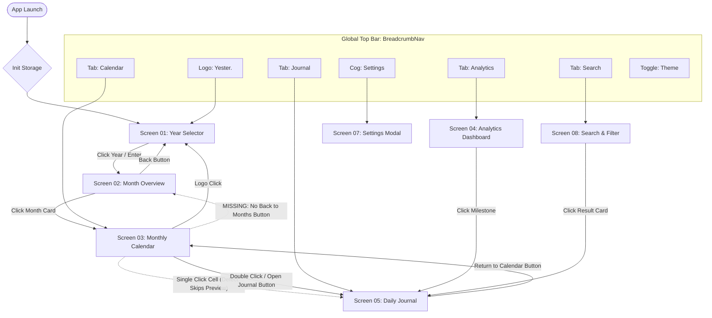
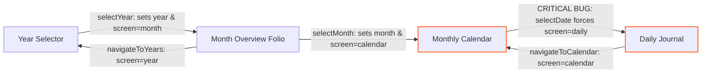
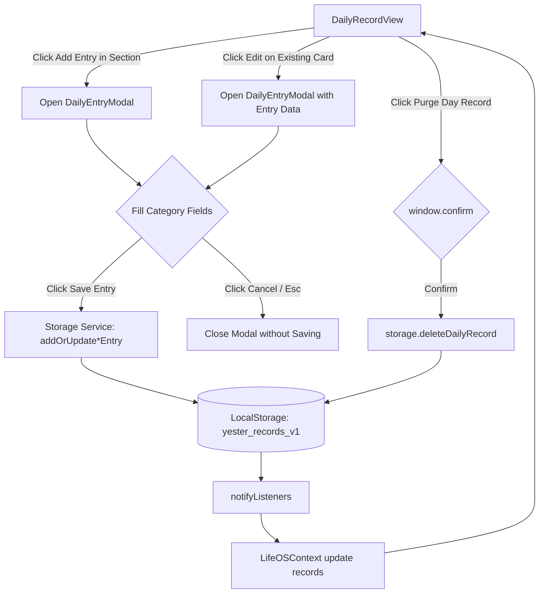
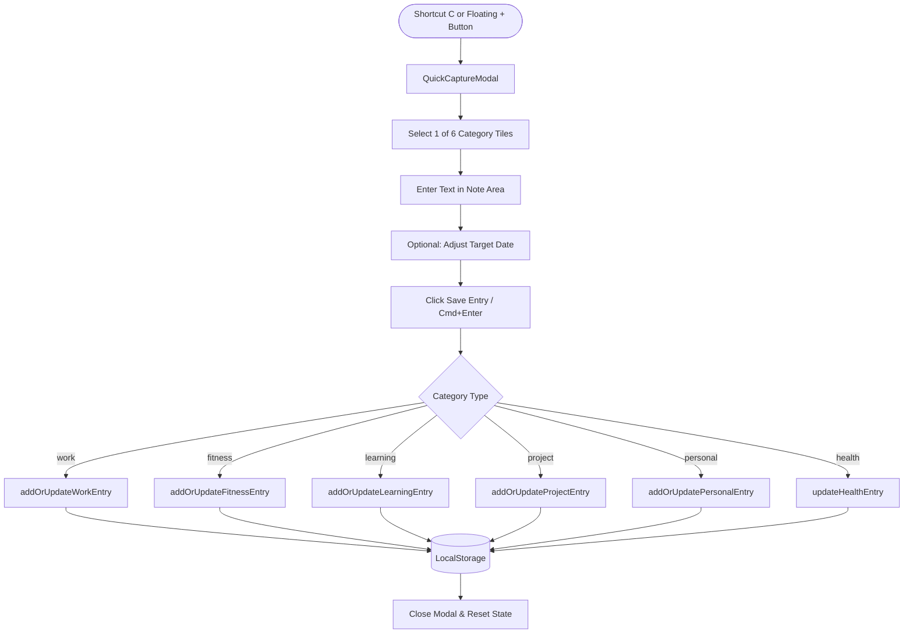
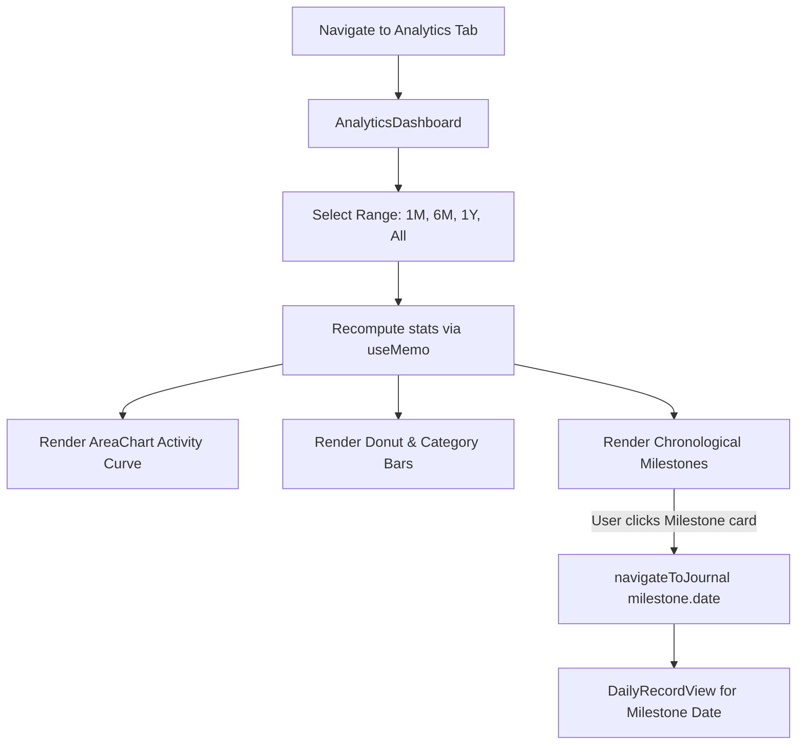
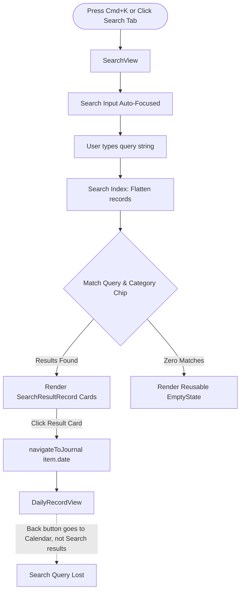
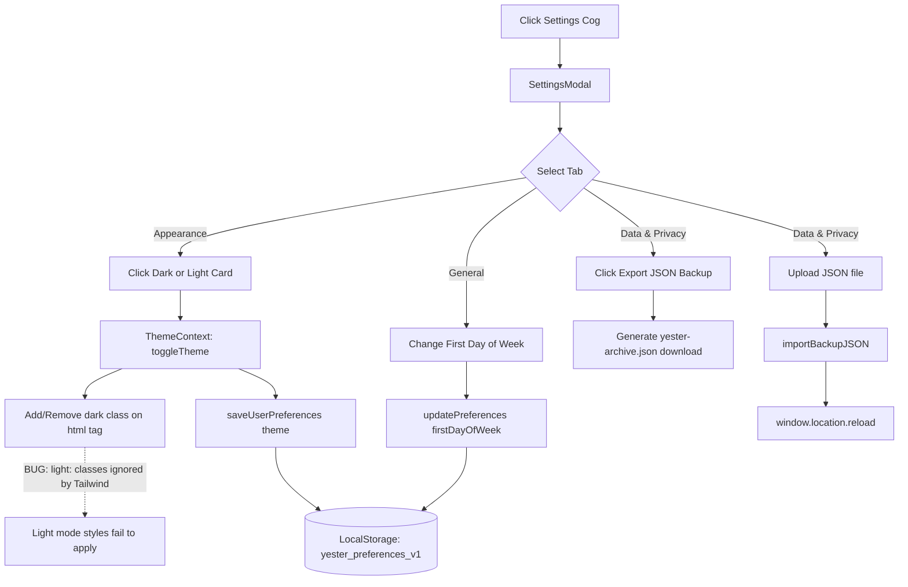
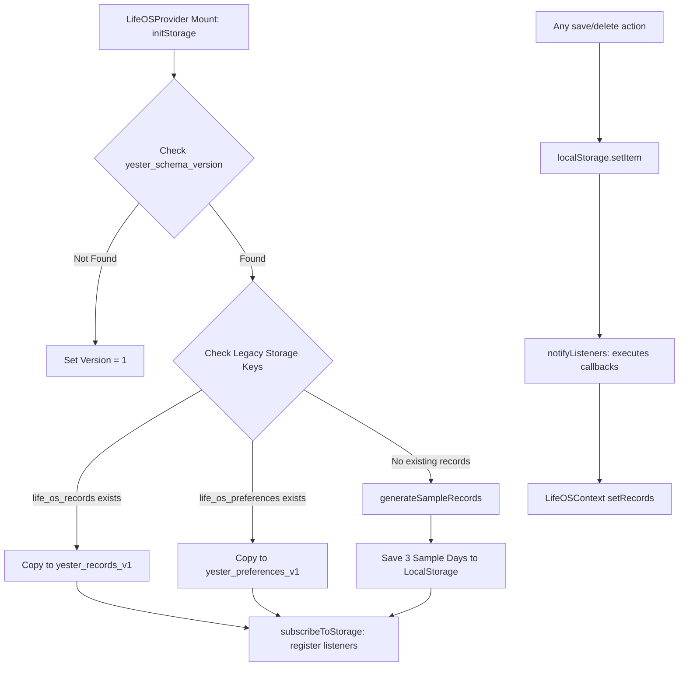

# YESTER — COMPLETE APPLICATION FORENSIC AUDIT, UX FLOW ANALYSIS & DESIGN IMPLEMENTATION REPORT

**Audit Date:** November 16, 2026  
**Auditor Roles:** Principal Software Architect, Senior Product Designer, UX Auditor, Frontend Engineering Lead, QA Architect  
**Project Inspected:** `/home/rushi/projects/yester`  
**Current Git Commit:** `f2027c2` on branch `main`  
**Application Target:** Yester (Calendar-First Personal Life Archive & Growth Operating System)  
**Verification Environment:** Linux, Node.js v22.14.0, Vite v5.4.21, React 18.3.1, TypeScript 5.5.3, Tailwind CSS 3.4.11  

---

# EXECUTIVE SUMMARY

This forensic audit represents an exhaustive, code-level and interaction-level investigation of the complete **Yester** web application. Every file, component, hook, context, utility, style rule, and state transition was inspected against the product vision: *"Every yesterday shapes who you become tomorrow."*

### Key Verdict
The application has established an impressive, high-fidelity visual foundation that successfully escapes the generic SaaS dashboard paradigm, employing editorial serif typography (*Newsreader*), a controlled dark canvas (`#090A0C`), and restrained Signal Orange accents (`#FF7138`). Core data models and local persistence mechanisms are robustly defined with versioned schemas.

However, beneath the polished surface, the audit uncovered **critical architectural disconnects, navigation dead-ends, state lifecycle anomalies, and silent CSS failures** that would severely degrade user trust in a production environment:

1. **Catastrophic Light Theme Failure (`light:` Tailwind Prefix)**: 323 Tailwind class instances across 18 components use the `light:` prefix (e.g., `light:bg-[#FCFCFC]`). Because Tailwind CSS has `darkMode: 'class'` configured without a custom `light` variant plugin, **every single `light:` utility rule was completely dropped by the compiler**. In light mode, the UI fails to switch its surfaces and remains trapped in hardcoded dark background values.
2. **Calendar Date Selection Usability Trap**: When a user single-clicks any date cell in `MonthlyCalendar.tsx`, `LifeOSContext.tsx:129` immediately executes `setScreen('daily')`. This instantaneously yanks the user off the calendar and navigates them to the Daily Journal, rendering the entire right-hand **Date Preview Panel** (`June Overview / Date Snapshot`) completely un-previewable.
3. **Permanent Dead-End for the 12-Month Folio**: Once a user enters the Monthly Calendar, there is **zero UI mechanism** to return to the 12-month annual overview (`MonthSelector.tsx`). The context function `navigateToMonths()` exists in `LifeOSContext.tsx:145` but is **never invoked anywhere in the codebase**.
4. **Hardcoded Analytics KPI Deltas & Fallbacks**: The top KPI cards in `AnalyticsDashboard.tsx` display hardcoded deltas (`+12%`, `+8%`, `+3`) and hardcoded fallback values (`stats.totalMilestones || 12`), and the growth trend card hardcodes `+18%` regardless of actual stored records.
5. **Orphaned Components & Dead Code**: `CategoryAnalyticsPanel.tsx` is completely unreferenced dead code (6.1 KB). `CategoryDetailModal.tsx` is mounted in `App.tsx` but its trigger `openCategoryAnalytics()` is never called by any active component.
6. **Total Absence of URL Routing & History**: The application runs entirely on volatile React memory state (`screen`). Browser Back and Forward buttons break navigation (Back exits the app entirely). Every browser page refresh (`F5`) forcibly resets the application back to the full-screen Year Selector (`'year'`), obliterating the user's active temporal context.
7. **Sunday-First Calendar Offset Bug**: While `MonthlyCalendar.tsx` swaps the column header labels to `Sun, Mon, Tue...` when Sunday is selected in settings, the underlying grid generator in `calendarService.ts:98` hardcodes `getFirstWeekdayOfMonthMondayFirst`. This misaligns every date cell by exactly one column under Sunday headers.

---

# PART 1 — PROJECT RECONNAISSANCE

## 1.1 Complete Repository Structure
```
/home/rushi/projects/yester
├── index.html
├── package.json
├── package-lock.json
├── postcss.config.js
├── tailwind.config.js
├── tsconfig.json
├── tsconfig.node.json
├── vite.config.ts
├── docs/
│   └── YESTER_COMPLETE_PRODUCT_AUDIT.md (This Document)
└── src/
    ├── App.tsx
    ├── main.tsx
    ├── components/
    │   ├── common/
    │   │   ├── Badge.tsx
    │   │   ├── BreadcrumbNav.tsx
    │   │   ├── Button.tsx
    │   │   ├── EmptyState.tsx
    │   │   ├── Modal.tsx
    │   │   └── ThemeToggle.tsx
    │   ├── daily/
    │   │   ├── DailyEntryModal.tsx
    │   │   ├── FitnessSection.tsx
    │   │   ├── HealthSection.tsx
    │   │   ├── LearningSection.tsx
    │   │   ├── PersonalSection.tsx
    │   │   ├── ProjectsSection.tsx
    │   │   ├── ReflectionSection.tsx
    │   │   └── WorkSection.tsx
    │   ├── quickCapture/
    │   │   └── QuickCaptureModal.tsx
    │   └── screens/
    │       ├── AnalyticsDashboard.tsx
    │       ├── CategoryAnalyticsPanel.tsx   [DEAD CODE]
    │       ├── CategoryDetailModal.tsx      [ORPHANED TRIGGER]
    │       ├── DailyRecordView.tsx
    │       ├── MonthSelector.tsx
    │       ├── MonthlyCalendar.tsx
    │       ├── SearchView.tsx
    │       ├── SettingsModal.tsx
    │       └── YearSelector.tsx
    ├── context/
    │   ├── LifeOSContext.tsx
    │   └── ThemeContext.tsx
    ├── services/
    │   ├── analyticsService.ts
    │   ├── calendarService.ts
    │   ├── sampleData.ts
    │   └── storage.ts
    ├── styles/
    │   └── index.css
    ├── types/
    │   └── index.ts
    └── utils/
        ├── cn.ts
        └── dateUtils.ts
```

## 1.2 Entry Point, Providers & Mounting Hierarchy
The application mounts in `src/main.tsx` via `ReactDOM.createRoot`:
```tsx
// src/main.tsx:8-16
ReactDOM.createRoot(document.getElementById('root')!).render(
  <React.StrictMode>
    <ThemeProvider>
      <LifeOSProvider>
        <App />
      </LifeOSProvider>
    </ThemeProvider>
  </React.StrictMode>
);
```
- **Context Nesting Order**: `ThemeProvider` wraps `LifeOSProvider`, which wraps `App`.
- **Side Effect on Mount**: `LifeOSProvider` (`src/context/LifeOSContext.tsx:76`) executes `initStorage()`, ensuring schema migration from legacy keys (`life_os_*` -> `yester_*`) and populating initial seed records if localStorage is vacant.
- **Root Element in `index.html`**:
  ```html
  <body class="bg-[#090909] text-[#EDEDED] selection:bg-[#E5E5E5] selection:text-[#090909] antialiased">
    <div id="root"></div>
  </body>
  ```
  *Inconsistency*: `index.html` hardcodes `bg-[#090909]`, whereas `src/styles/index.css` specifies `var(--bg)` (`#090A0C`), and `App.tsx:68` hardcodes `bg-[#090A0C]`.

## 1.3 Routing Implementation (Or Lack Thereof)
The application **does not use a client-side router** (such as React Router, TanStack Router, or HTML5 History API).
Routing is strictly managed through an in-memory enum state in `LifeOSContext.tsx`:
```ts
// src/types/index.ts:178
export type ScreenMode = 'year' | 'month' | 'calendar' | 'daily' | 'analytics' | 'search';
```
In `src/App.tsx:44-49`:
```tsx
<main className="flex-1 w-full">
  {screen === 'year' && <YearSelector />}
  {screen === 'month' && <MonthSelector />}
  {screen === 'calendar' && <MonthlyCalendar />}
  {screen === 'daily' && <DailyRecordView />}
  {screen === 'analytics' && <AnalyticsDashboard />}
  {screen === 'search' && <SearchView />}
</main>
```
### Severe Architectural Ramifications:
- **Zero URL Deep Linking**: The URL remains perpetually `http://localhost:5173/`. A user cannot bookmark a specific date (e.g., `/journal/2026-11-16`), link to their analytics (`/analytics`), or share a search query (`/search?q=rust`).
- **Browser Back Button Exits the App**: Because no history entries are pushed (`history.pushState`), hitting the browser back button pops the user out of the site entirely to their previous browser tab.
- **Refresh Resets to Year Selector**: In `LifeOSContext.tsx:83`, `const [screen, setScreen] = useState<ScreenMode>('year')`. Pressing `F5` / Refresh always resets the screen to `'year'`, resetting `selectedDate` to today and discarding the user's navigational state.

## 1.4 Reconnaissance Findings: Dead Code, Unused Components & Redundancies

| Item | File Path | Finding Type | Detailed Forensic Finding |
|---|---|---|---|
| `CategoryAnalyticsPanel.tsx` | `src/components/screens/CategoryAnalyticsPanel.tsx` | **Dead Code** | 6,167 bytes (186 lines). Was previously the right-hand panel in the legacy calendar. Completely unreferenced in any active component. Not imported by `App.tsx`, `MonthlyCalendar.tsx`, or any other file. |
| `CategoryDetailModal.tsx` | `src/components/screens/CategoryDetailModal.tsx` | **Orphaned Component** | 14,910 bytes (337 lines). Mounted in `App.tsx:87`, but its opening trigger `openCategoryAnalytics()` is never called anywhere in the UI. Consumes bundle space without being accessible. |
| `getAllCategoriesMonthlyMetrics` | `src/services/analyticsService.ts:236` | **Dead Function** | Exported function only used inside dead file `CategoryAnalyticsPanel.tsx`. |
| `navigateToMonths()` | `src/context/LifeOSContext.tsx:145` | **Unused Context Function** | Context exposes `navigateToMonths()`, but it is never imported or bound to any UI click handler across all screens. |
| `SearchResultItem` | `src/types/index.ts:180-189` | **Dead Interface** | Defined in global types, but `SearchView.tsx:16` declared its own duplicate local interface `SearchResultRecord`. |
| `light:` Tailwind Variants | 18 files across `src/` | **Broken Styling Rule** | 323 instances of `light:*` utility classes dropped at build time due to missing custom Tailwind plugin. |
| Hardcoded KPI Calculations | `src/components/screens/AnalyticsDashboard.tsx` | **Hardcoded / Fake Telemetry** | Lines 195, 221, 247, 396 hardcode `+12%`, `+8%`, `+3`, `|| 12`, and `+18%` deltas instead of calculating deltas against preceding time ranges. |
| Profile Avatar Button | `src/components/common/BreadcrumbNav.tsx:172-177` | **Dead Interactive Element** | Styled with `cursor-pointer` and tooltip "Sovereign Life Archive", but carries **no `onClick` handler**. Clicking does nothing. |
| Hardcoded Monday in Grid Generator | `src/services/calendarService.ts:98` | **Logic Bug** | Hardcodes `getFirstWeekdayOfMonthMondayFirst` while UI headers switch to Sunday, causing 1-day column drift. |

---

# PART 2 — COMPLETE PAGE-BY-PAGE INVENTORY

Every screen and overlay existing in the compiled codebase is cataloged below:

```
┌────────────────────────────────────────────────────────────────────────┐
│                              APPLICATION                               │
└───────────────────────────────────┬────────────────────────────────────┘
                                    │
           ┌────────────────────────┴────────────────────────┐
           ▼                                                 ▼
┌──────────────────────┐                         ┌───────────────────────┐
│     TOP HEADER       │                         │       OVERLAYS        │
│  (BreadcrumbNav.tsx) │                         │  - QuickCaptureModal  │
└──────────┬───────────┘                         │  - SettingsModal      │
           │                                     │  - DailyEntryModal    │
           │                                     │  - CategoryDetail*    │
           │                                     └───────────────────────┘
           ├─────────────────────────┬─────────────────────────┬─────────────────────────┐
           ▼                         ▼                         ▼                         ▼
┌─────────────────────┐   ┌─────────────────────┐   ┌─────────────────────┐   ┌─────────────────────┐
│      CALENDAR       │   │      ANALYTICS      │   │       JOURNAL       │   │       SEARCH        │
│    (Sub-Flow)       │   │(AnalyticsDashboard) │   │ (DailyRecordView)   │   │    (SearchView)     │
└──────────┬──────────┘   └─────────────────────┘   └─────────────────────┘   └─────────────────────┘
           │
           ├─────────────────────────┐
           ▼                         ▼
┌─────────────────────┐   ┌─────────────────────┐
│    YEAR SELECTOR    │   │   MONTH SELECTOR    │
│  (YearSelector.tsx) │   │ (MonthSelector.tsx) │
└──────────┬──────────┘   └──────────┬──────────┘
           │                         │
           └────────────► ◄──────────┘
                         │
                         ▼
              ┌─────────────────────┐
              │  MONTHLY CALENDAR   │
              │(MonthlyCalendar.tsx)│
              └─────────────────────┘
```
*\* Note: CategoryDetailModal is mounted in App.tsx but has no working trigger.*

---

## Screen 01 — Year Selector (`YearSelector.tsx`)
* **Purpose**: Temporal point-of-entry and macro-horizon selector. Allows users to scroll across historical years (current year ± 14 years).
* **Entry Condition**: Active on initial application load (`screen === 'year'`) or when the user clicks the "Yester." logo in `BreadcrumbNav.tsx`.
* **Accessible From**: Application root or logo button in global header.
* **Parent / Child Relationships**: Parent of `MonthSelector.tsx`.
* **Components Rendered**:
  * Architectural hairline grid background (`[mask-image:radial-gradient(...)]`).
  * Top minimal header: Brand mark `Yester.`, sub-label `Personal Chronology`, tagline *"Every yesterday shapes who you become tomorrow."*, Sample Data toggle button (`loadSampleData` / `clearSampleData`), `ThemeToggle`.
  * Vertical scroll carousel: 29 year nodes (`currentYear - 14` to `currentYear + 14`).
  * Center focus bracket: Framing lines labeled `[ ERA ]` and `PRESENT` / `ARCHIVE` / `HORIZON`.
  * Directional chevrons: `ChevronUp` and `ChevronDown` for year stepping.
  * Primary Action: `Button` labeled `Enter {activeYear} • Open Year`.
  * Footer metadata: `Yester • Living Chronicle` and `YEAR → MONTH → CALENDAR → RECORD`.
* **Data Consumed**: `year` from `LifeOSContext`, `hasSampleData` boolean.
* **State Used**: Component-local `activeYear` (number), `containerRef`, `scrollRafRef` for `requestAnimationFrame` center-detection.
* **Interactive Triggers**:
  * Mouse wheel / drag scroll: Updates `activeYear` to the node nearest to vertical midpoint.
  * Keyboard `ArrowUp` / `ArrowDown`: Shifts active year by ±1 with smooth scroll.
  * Keyboard `Enter`: Commits `selectYear(activeYear)`.
  * Single click on any year node: Executes `selectYear(y)` immediately.
  * Click on Primary Button: Executes `selectYear(activeYear)`.
* **Exit Navigation**: Transitions to `MonthSelector.tsx` (`screen = 'month'`).
* **Empty / Error States**: None. Always generates 29 years mathematically.
* **Implementation Status**: **Fully Implemented**.

---

## Screen 02 — Month Overview / 12-Month Folio (`MonthSelector.tsx`)
* **Purpose**: Displays the 12 calendar chapters of the selected year with cumulative activity metrics and mini-sparklines.
* **Entry Condition**: Rendered when `screen === 'month'`.
* **Accessible From**: `YearSelector.tsx` upon year selection.
* **Parent / Child Relationships**: Child of `YearSelector.tsx`; Parent of `MonthlyCalendar.tsx`.
* **Components Rendered**:
  * Back button: `< ArrowLeft` with label "Select another year" (`onClick={navigateToYears}`).
  * Header banner: Big year numeral `{year}` in Newsreader serif, sub-title `Annual Chronicle`, description.
  * Annual KPI pill: Total active days (`/ 365`) and total recorded entries across the year.
  * 12-Month Grid: 12 cards representing January through December with Roman numerals (`PART I` to `PART XII`), month number (`#01` to `#12`), day counts (`31 days`), active badges (`Current` if this month), and category entry pill badges.
* **Data Consumed**: `getAllMonthsForYear(year, records)` from `calendarService.ts`.
* **Interactive Triggers**:
  * Click on back button: Navigates back to `YearSelector.tsx` (`screen = 'year'`).
  * Click on any month card: Executes `selectMonth(m.month)`, navigating to `MonthlyCalendar.tsx`.
* **Exit Navigation**:
  * Forward: `MonthlyCalendar.tsx` (`screen = 'calendar'`).
  * Backward: `YearSelector.tsx` (`screen = 'year'`).
* **Empty State**: Renders empty metrics (`0 Active Days`) if the year has no entries.
* **Implementation Status**: **Partially Implemented**. (Missing: Once the user advances to `MonthlyCalendar.tsx`, they can **never navigate back to this screen** because `navigateToMonths` is unhooked).

---

## Screen 03 — Monthly Calendar (`MonthlyCalendar.tsx`)
* **Purpose**: Primary temporal navigation grid for a single month. Displays individual days with activity pips and features a compact right-hand **Date Preview Panel**.
* **Entry Condition**: Rendered when `screen === 'calendar'`.
* **Accessible From**: `MonthSelector.tsx`, top header "Calendar" tab, or "Return to Calendar" button in `DailyRecordView.tsx`.
* **Components Rendered**:
  * Month Header: Previous month chevron (`<`), Month name & year (`June 2026`), Next month chevron (`>`), Jump to Today button, Quick Capture button.
  * Calendar Grid Left: 7 column headers (`MON - SUN` or `SUN - SAT`), 35 or 42 day cells with day numbers, today ring, selected date solid circle, activity snippet, category pips (Work: Orange, Fitness: Blue, Learning: Green, Personal: Amber, Projects: Purple).
  * Right Column (Date Preview Panel):
    * `{MonthName} Overview` with completion percentage and progress bar.
    * Category breakdown lines (Work %, Fitness %, Learning %, Personal %).
    * 30-day monthly cadence area sparkline in Signal Orange (`AreaChart`).
    * Selected Date Snapshot Card: Header, formatted date, reflection headline or summary snippet, "Open Journal →" primary button.
* **Data Consumed**: `generateCalendarGrid(year, month, selectedDate, records)`, `records[selectedDate]`, `preferences`.
* **Interactive Triggers**:
  * Month chevrons: Decrement/increment month via `selectMonth()`.
  * Date cell single click: Calls `selectDate(cell.date)` -> **CRITICAL BUG: Immediately forces `screen = 'daily'`, bypassing the preview card**.
  * Date cell double-click: Calls `navigateToJournal(cell.date)`.
  * "Open Journal →" button in snapshot card: Calls `navigateToJournal(selectedDate)`.
  * "Quick Capture" button: Opens `QuickCaptureModal`.
* **Exit Navigation**:
  * Forward: `DailyRecordView.tsx` (`screen = 'daily'`).
  * Backward: **None**. Cannot return to `MonthSelector.tsx`.
* **Implementation Status**: **Partially Implemented & Defective**. (Severe interaction bug on single click; dead-end back navigation; Sunday-first offset bug).

---

## Screen 04 — Dedicated Analytics Dashboard (`AnalyticsDashboard.tsx`)
* **Purpose**: Top-level macro analytical dashboard showing growth trends, category distributions, consistency metrics, and milestone archives.
* **Entry Condition**: Rendered when `screen === 'analytics'`.
* **Accessible From**: "Analytics" tab in `BreadcrumbNav.tsx`.
* **Components Rendered**:
  * Header: Title `Your Journey in {year}`, description, time range pills (`1M`, `6M`, `1Y`, `All`).
  * 3 Top KPI Cards: Days Recorded (Calendar icon, `+12%`), Consistency Rate (BarChart icon, `+8%`), Total Milestones (Trophy icon, `+3`).
  * Main Activity Chart: Recharts `AreaChart` with Signal Orange gradient showing normalized monthly activity curve (Jan–Dec).
  * Bottom Left Card (Top Categories): Horizontal progress bars + Recharts `PieChart` donut chart with inner radius 48, outer radius 68.
  * Bottom Right Card (Growth Trend): Large `+18%` stat + mini trendline area chart.
  * Recent Milestones Section: Chronological list of project and work milestones with date badges and click-to-view navigation.
* **Data Consumed**: Calculated inline from `records` using `useMemo`.
* **State Used**: `timeRange` (`'1M' | '6M' | '1Y' | 'All'`).
* **Interactive Triggers**:
  * Clicking time range pills: Switches `timeRange`.
  * Clicking a milestone item: Calls `navigateToJournal(milestone.date)`, jumping directly to that day's journal.
* **Exit Navigation**: User must click another top tab (`Calendar`, `Journal`, `Search`, or Logo).
* **Empty State**: Displays zero counts and informational fallback text for milestones.
* **Implementation Status**: **Partially Implemented** (Visually complete, but deltas and growth percentages are hardcoded).

---

## Screen 05 — Daily Journal (`DailyRecordView.tsx`)
* **Purpose**: Deep editorial day record. Displays and edits everything that occurred on a specific date across 7 life pillars.
* **Entry Condition**: Rendered when `screen === 'daily'`.
* **Accessible From**: Clicking a date cell in `MonthlyCalendar.tsx`, clicking "Journal" tab in `BreadcrumbNav.tsx`, clicking a search result in `SearchView.tsx`, or clicking a milestone in `AnalyticsDashboard.tsx`.
* **Components Rendered**:
  * Pagination header: Back to calendar link, previous day chevron (`<`), date title (`Tuesday, June 25, 2024`), day-of-year index (`Day 177 • 2024`), next day chevron (`>`), Quick Capture button.
  * Editorial Hero: Newsreader serif headline epigraph (*"A productive day and a clear mind."*), inline editing input, Visual Memory cover photo card.
  * Category Pills Bar: Live counters for Work, Fitness, Learning, Personal, Projects. Clicking opens entry modal.
  * 7 Vertical Sections:
    1. `WorkSection`: Organization, project, tasks, problems, solutions, tech stack, evidence links.
    2. `FitnessSection`: Workout type, duration, exercises (sets, reps, weight), cardio details, notes.
    3. `LearningSection`: Subject, concept, source, study duration, practical implementation.
    4. `ProjectsSection`: Project name, objective, progress bar, tasks completed, repository links.
    5. `PersonalSection`: Title, type badge, description, people involved, significance.
    6. `HealthSection`: Sleep hours, water intake, daily habit checklist with checkboxes.
    7. `ReflectionSection`: Went well, went wrong, learned, should improve, priorities tomorrow, freeform notes.
  * Footer: Target date display and red "Purge Daily Record" button with `window.confirm`.
  * Modal: `DailyEntryModal` mounted for modal editing.
* **Data Consumed**: `records[selectedDate]` or `getOrCreateDailyRecord(selectedDate)`.
* **Interactive Triggers**:
  * Previous / Next day chevrons: Shifts `selectedDate` by ±1 day.
  * Click headline: Opens inline input to edit daily epigraph.
  * "Add Entry" / "Edit" on any section: Opens `DailyEntryModal`.
  * "Purge Daily Record": Deletes the entire record from `localStorage`.
  * Habit checkbox click: Directly mutates habit boolean in `localStorage`.
* **Exit Navigation**: Back link returns to `MonthlyCalendar.tsx` (`screen = 'calendar'`).
* **Implementation Status**: **Fully Implemented**.

---

## Screen 06 — Quick Capture Modal (`QuickCaptureModal.tsx`)
* **Purpose**: Rapid, low-friction entry point for jotting down moments without navigating through full forms.
* **Entry Condition**: Triggered by pressing `C` keyboard shortcut, clicking the floating orange `+` button in bottom right, or clicking "Capture" in top header.
* **Components Rendered**:
  * Modal backdrop with blur.
  * 2×3 category grid: Work, Fitness, Learning, Project, Personal, Health.
  * Textarea: `Add a note (optional)...`.
  * Date target switcher: Shows target date with toggleable date picker.
  * Keyboard hint: `⌘ + Enter to save`.
  * Primary Action: Full-width Signal Orange `Save Entry →` button.
* **Data Consumed**: `quickCapture.initialCategory`, `quickCapture.initialDate`.
* **Persistence**: Writes directly to `localStorage` via category-specific storage functions.
* **Implementation Status**: **Fully Implemented**.

---

## Screen 07 — Settings Modal (`SettingsModal.tsx`)
* **Purpose**: Configuration hub for theme, calendar preferences, and data backup/export.
* **Entry Condition**: Triggered by clicking the Settings cog icon in `BreadcrumbNav.tsx`.
* **Components Rendered**:
  * Left sidebar tabs: `Appearance`, `General`, `Data & Privacy`, `About Yester`.
  * Appearance Tab: Dark Theme card (Moon icon, "Easy on your eyes") and Light Theme card (Sun icon, "Bright and clean") with active orange checkmarks.
  * General Tab: First Day of Week selector (Monday vs Sunday), Reduced Motion checkbox.
  * Data & Privacy Tab: Export JSON Backup button, Import JSON Backup file input, Clear All Data button with double-confirmation toggle.
  * About Tab: Version `v1.0.0`, tagline, offline-storage notice.
  * Footer: Orange "Done" button (`onClick={closeSettings}`).
* **State Used**: `activeTab`, `confirmClear`, `importStatus`.
* **Implementation Status**: **Fully Implemented** (Note: Light theme visual rendering is impaired by the Tailwind bug).

---

## Screen 08 — Search & Filter View (`SearchView.tsx`)
* **Purpose**: Global archive search across all entries, tasks, reflections, and notes.
* **Entry Condition**: Triggered by clicking "Search" tab in `BreadcrumbNav.tsx` or pressing `⌘ + K` / `Ctrl + K`.
* **Components Rendered**:
  * Search bar: Search icon, auto-focused text input, `Press ⌘ + K` badge.
  * Category filter chips: `All`, `Work`, `Fitness`, `Learning`, `Personal`, `Health`, `Projects`.
  * Sort dropdown: `Newest First` vs `Oldest First`.
  * Results list: Date badge (`JUN 25`), category pill, title, excerpt snippet, navigation arrow.
  * Empty State: `EmptyState` component rendered when zero items match query.
* **Data Consumed**: Flattens and searches all entries in `records`.
* **Interactive Triggers**:
  * Input typing: Filters results in real-time.
  * Category pill click: Filters by category.
  * Result card click: Calls `navigateToJournal(item.date)`, opening that day in `DailyRecordView.tsx`.
* **Exit Navigation**: User must click a header tab. **No back button or `Escape` key handler exists**.
* **Implementation Status**: **Partially Implemented** (Missing return navigation; search index omits reflection structured fields).

---

## Overlay A — Daily Entry Modal (`DailyEntryModal.tsx`)
* **Purpose**: Comprehensive, multi-field form modal for authoring deep structured logs in any category.
* **Size**: 1,351 lines of code.
* **Location**: Mounted inside `DailyRecordView.tsx`.
* **Fields Supported**:
  * *Work*: Org, Project, Role, Tasks, Problems, Root Causes, Approach, Solution, Decisions, Tech, Outcome, Evidence Links, Lessons, Reflections.
  * *Fitness*: Type, Duration, Bodyweight, Muscle groups, Exercise table (Sets, Reps, Weight), Cardio (Type, Duration, Distance), PRs, Notes.
  * *Learning*: Subject, Concept, Source, Duration, What understood, What to improve, Problems solved, Practical application, Notes.
  * *Projects*: Name, Objective, Progress %, Tasks completed, Tech implemented, Decisions, Blockers, Next steps, Repo URL, Notes.
  * *Personal*: Title, Type, People involved, Description, Significance, Location.
  * *Health*: Sleep hours, Sleep quality, Water liters, Habit list builder.
  * *Reflection*: Went well, Went wrong, Lessons learned, Areas to improve, Tomorrow's priorities, Freeform journal.
* **Implementation Status**: **Fully Implemented**.

---

## Overlay B — Category Detail Modal (`CategoryDetailModal.tsx`)
* **Purpose**: Intended to show an in-depth monthly telemetry dossier for a specific category with historical area charts and entry logs.
* **Size**: 337 lines of code.
* **Location**: Mounted in `App.tsx:87`.
* **Fatal Defect**: **Completely Unreachable**. Triggered by `activeCategoryModal`, which is set by `openCategoryAnalytics(category)`. No button or link anywhere in the UI calls `openCategoryAnalytics()`.
* **Implementation Status**: **Orphaned / Unreachable Component**.

---

# PART 3 — EVERY ELEMENT AND COMPONENT AUDIT

An audit of interactive and visual elements across the application:

| Element Name | Component File | Page / Location | Purpose | Observed Interaction / Behavior | State / Data Source | Persistence | Status | Identified Issue |
|---|---|---|---|---|---|---|---|---|
| Brand Mark `Yester.` | `BreadcrumbNav.tsx:38-49` | Top Header (Left) | Global brand home anchor | Single click calls `navigateToYears()` | `LifeOSContext.setScreen` | In-memory only | **Working** | Always jumps all the way back to the Year Selector instead of previous screen. |
| Navigation Tab: Calendar | `BreadcrumbNav.tsx:54-66` | Top Header (Center) | Switch to Monthly Calendar | Single click calls `navigateToCalendar()` | `screen === 'calendar'` | In-memory only | **Working** | If user was on `month` (12-month folio), clicking Calendar jumps to `MonthlyCalendar`, skipping the folio. |
| Navigation Tab: Analytics | `BreadcrumbNav.tsx:68-80` | Top Header (Center) | Switch to Analytics Dashboard | Single click calls `navigateToAnalytics()` | `screen === 'analytics'` | In-memory only | **Working** | Correctly navigates to dedicated Analytics view. |
| Navigation Tab: Journal | `BreadcrumbNav.tsx:82-94` | Top Header (Center) | Switch to Daily Journal | Single click calls `navigateToJournal()` | `screen === 'daily'` | In-memory only | **Working** | Opens journal for currently selected date. |
| Navigation Tab: Search | `BreadcrumbNav.tsx:96-108` | Top Header (Center) | Switch to Search & Filter view | Single click calls `navigateToSearch()` | `screen === 'search'` | In-memory only | **Working** | Opens search view. |
| Sample Data Pill | `BreadcrumbNav.tsx:114-135` | Top Header (Right) | Indicator & toggle for demo records | Clicking "Clear" purges sample records; clicking "Load Sample" seeds records | `hasSampleData`, `storage.ts` | LocalStorage | **Working** | Useful developer/demo feature, but visible on production header. |
| Header Capture Button | `BreadcrumbNav.tsx:138-146` | Top Header (Right) | Trigger Quick Capture modal | Single click calls `openQuickCapture()` | `quickCapture.isOpen` | In-memory | **Working** | Redundant with floating orange button. |
| Search Icon Button | `BreadcrumbNav.tsx:149-156` | Top Header (Right) | Secondary search trigger | Single click calls `navigateToSearch()` | `screen` | In-memory | **Working** | Duplicates the "Search" text tab 40px away. |
| Theme Toggle Button | `ThemeToggle.tsx:9-25` | Top Header / Year Header | Toggle Dark / Light theme | Calls `toggleTheme()` in `ThemeContext` | `theme` in `localStorage` | LocalStorage | **Defective** | Class `light` is added to `<html>`, but 323 `light:` utility classes fail to compile. |
| Settings Cog Button | `BreadcrumbNav.tsx:162-169` | Top Header (Right) | Open Settings modal | Single click calls `openSettings()` | `isSettingsOpen` | In-memory | **Working** | Opens settings modal cleanly. |
| User Profile Avatar | `BreadcrumbNav.tsx:172-177` | Top Header (Right) | User account / profile menu | Styled with `cursor-pointer`, but **no click handler** | None | None | **Dead Element** | Visual dummy. Clicking produces no feedback or menu. |
| Year Scroll Carousel | `YearSelector.tsx:174-216` | Year Selector (Center) | Select active year | Mouse scroll or drag updates active year | `containerRef`, RAF center-calc | In-memory | **Working** | Center snap and RAF listener function as intended. |
| Year Node Numeral | `YearSelector.tsx:184-213` | Year Selector (Carousel) | Display year and click-to-enter | Single click executes `selectYear(y)` immediately | `years` array | In-memory | **Working** | Advances to MonthSelector. |
| Enter Year CTA Button | `YearSelector.tsx:234-243` | Year Selector (Bottom) | Confirm and enter year | Single click executes `selectYear(activeYear)` | `activeYear` | In-memory | **Working** | Uses `Button` component with `variant="primary"`. |
| Year Back Button | `MonthSelector.tsx:41-47` | Month Folio (Top) | Return to Year Selector | Single click executes `navigateToYears()` | `screen` | In-memory | **Working** | Correctly navigates back to YearSelector. |
| Month Chapter Card | `MonthSelector.tsx:82-164` | Month Folio (Grid) | Select month and advance | Single click executes `selectMonth(m.month)` | `getAllMonthsForYear()` | In-memory | **Working** | Navigates forward, but leaves no breadcrumb to return. |
| Calendar Month Prev/Next | `MonthlyCalendar.tsx:62-76` | Calendar Header (Left) | Decrement/increment month | Single click calls `selectMonth(prev/next)` | `month`, `year` | In-memory | **Working** | Smoothly updates calendar grid. |
| Calendar Jump to Today | `MonthlyCalendar.tsx:82-89` | Calendar Header (Right) | Snap view to current date | Single click calls `goToToday()` | System clock | In-memory | **Working** | Snaps to current year, month, and day. |
| Calendar Day Cell | `MonthlyCalendar.tsx:129-224` | Calendar Grid | View/select date on calendar | Single click calls `selectDate(cell.date)` | `grid` array | In-memory | **CRITICAL BUG** | **Forces navigation to `daily` screen on single click**, destroying the date preview panel. |
| Date Preview "Open Journal" | `MonthlyCalendar.tsx:492-501` | Calendar Right Panel | Open full journal for selected date | Single click calls `navigateToJournal(selectedDate)` | `selectedDate` | In-memory | **Unreachable via click** | Because single-clicking a day cell already leaves the screen, this button is redundant. |
| Analytics Time Range Pills | `AnalyticsDashboard.tsx:190-208` | Analytics Header (Right) | Filter time horizon (`1M, 6M, 1Y, All`) | Single click updates `timeRange` state | `timeRange` | In-memory | **Working** | Recomputes charts on the fly. |
| KPI Metric Delta Badges | `AnalyticsDashboard.tsx:220, 246, 272` | Analytics KPI Cards | Display growth delta vs prior period | Static visual badge (`+12%`, `+8%`, `+3`) | Hardcoded strings | None | **Fake Metric** | Hardcoded strings disguised as real computed metrics. |
| Growth Trend Card | `AnalyticsDashboard.tsx:392-429` | Analytics (Bottom Right) | Display annual momentum | Static `+18%` stat and arbitrary sliced chart | Hardcoded `+18%` | None | **Fake Metric** | Slices months 6–12 regardless of what year or month is stored. |
| Daily Headline Epigraph | `DailyRecordView.tsx:238-261` | Daily Journal (Hero) | Display/edit daily thesis | Click text opens inline input; click Save writes to record | `record.summary` | LocalStorage | **Working** | Updates headline in real-time. |
| Daily Memory Cover Image | `DailyRecordView.tsx:264-278` | Daily Journal (Hero Right) | Visual memory thumbnail | Hover causes zoom; displays photo | Hardcoded Unsplash URL | None | **Static Placeholder** | Always displays the same Unsplash sunset photo. No upload/customization. |
| Habit Checklist Checkbox | `HealthSection.tsx:112-137` | Daily Journal (Health) | Toggle daily habit completion | Single click calls `onToggleHabit(habit.id)` | `record.health.habits` | LocalStorage | **Working** | Persists checkbox state directly to localStorage. |
| Quick Capture Floating Button | `App.tsx:64-75` | Fixed Bottom Right | Trigger Quick Capture from anywhere | Single click calls `openQuickCapture()` | `quickCapture.isOpen` | In-memory | **Working** | Circular orange button with `Plus` icon. |
| Search Input Bar | `SearchView.tsx:205-224` | Search View (Top) | Real-time query search | Keyup filters `allSearchItems` across records | `query` string | In-memory | **Working** | Filters smoothly; auto-focuses on mount. |
| Search Result Item Card | `SearchView.tsx:265-312` | Search View (Results) | Navigate to matching journal record | Single click calls `navigateToJournal(item.date)` | `filteredItems` | In-memory | **Working** | Opens matching date in DailyRecordView. |
| Settings Theme Preview Cards | `SettingsModal.tsx:191-248` | Settings (Appearance) | Visual Dark/Light radio selection | Clicking Dark/Light card calls `toggleTheme()` | `theme` | LocalStorage | **Working** | Updates state and localStorage, but light mode CSS is broken. |
| JSON Backup Export Button | `SettingsModal.tsx:300-307` | Settings (Data & Privacy) | Download complete database as JSON | Single click triggers `.json` file download | `exportBackupJSON()` | LocalStorage | **Working** | Generates valid JSON blob backup. |
| JSON Backup Import Input | `SettingsModal.tsx:319-330` | Settings (Data & Privacy) | Restore database from JSON file | File picker reads JSON and reloads page | `importBackupJSON()` | LocalStorage | **Working** | Successfully parses and restores backup. |

---

# PART 4 — COMPLETE START-TO-END INTERACTION FLOW ANALYSIS

## 4.1 Detailed Tracing of the Core User Journey

### Journey 1: First Application Entry & Initialization
1. User loads `http://localhost:5173/`.
2. Browser executes `main.tsx`, mounting `ThemeProvider` and `LifeOSProvider`.
3. `LifeOSProvider` runs `initStorage()` in `useEffect` (`LifeOSContext.tsx:76`).
   - Checks `localStorage` for `yester_schema_version`.
   - If empty, seeds initial sample records (`generateSampleRecords()`) for today, yesterday, and 5 days ago.
   - Loads preferences (`theme: 'dark'`, `firstDayOfWeek: 1`).
4. `LifeOSContext` initializes state:
   - `screen = 'year'`
   - `year = currentYear` (e.g., 2026)
   - `month = currentMonth` (e.g., 11)
   - `selectedDate = todayKey` (e.g., `2026-11-16`)
5. In `App.tsx`:
   - `BreadcrumbNav.tsx` checks `if (screen === 'year') return null;`. Header is hidden.
   - `<main>` renders `<YearSelector />`.
   - Floating Quick Capture button is hidden (`screen !== 'year'`).

---

### Journey 2: Year Selection to Month Selection
1. In `YearSelector.tsx`, user scrolls through the 29-year carousel or presses `ArrowDown`.
2. `handleScroll` fires via `requestAnimationFrame`, calculating distance from each `#year-node-${y}` to container center.
3. Component updates `activeYear`.
4. User clicks year `2024` or clicks `Enter 2024 • Open Year` button.
5. Event handler executes `selectYear(2024)`.
6. `LifeOSContext.tsx:111-114`:
   ```ts
   const selectYear = useCallback((newYear: number) => {
     setYear(newYear);
     setScreen('month');
   }, []);
   ```
7. `App.tsx` rerenders:
   - `BreadcrumbNav.tsx` now mounts (shows `Yester.`, tabs: Calendar, Analytics, Journal, Search, theme toggle, settings cog).
   - `Calendar` tab is highlighted with orange underline (`screen === 'month'`).
   - `<main>` unmounts `YearSelector` and mounts `MonthSelector`.
   - Floating Quick Capture button appears in bottom right.

---

### Journey 3: Month Selection to Monthly Calendar
1. In `MonthSelector.tsx`, `getAllMonthsForYear(2024, records)` calculates metrics for all 12 months.
2. User clicks month card `PART VI • #06 • June`.
3. Event handler executes `selectMonth(6)`.
4. `LifeOSContext.tsx:116-122`:
   ```ts
   const selectMonth = useCallback((newMonth: number) => {
     setMonth(newMonth);
     const currentDateParts = parseDateKey(selectedDate);
     const safeDay = Math.min(currentDateParts.day, 28);
     setSelectedDate(formatDateKey(year, newMonth, safeDay));
     setScreen('calendar');
   }, [year, selectedDate]);
   ```
5. `App.tsx` rerenders:
   - `<main>` unmounts `MonthSelector` and mounts `MonthlyCalendar`.
   - Grid generates 30 day cells for June 2024 + trailing May days + leading July days.
   - `selectedDate` defaults to `2024-06-16` (or safe day).

---

### Journey 4: The Defective Calendar Date Click Interaction
1. User sees the calendar grid on the left and the **Date Preview Panel** on the right.
2. User clicks date cell `June 25, 2024` to preview that day's summary in the right-hand panel.
3. **What was supposed to happen**:
   - `selectedDate` updates to `2024-06-25`.
   - Date cell `25` gains the solid orange circle.
   - Right-hand Date Snapshot updates to show June 25th summary.
   - Screen remains on `MonthlyCalendar`.
4. **What actually happens**:
   - Click handler triggers `selectDate(cell.date)` (`MonthlyCalendar.tsx:217`).
   - `LifeOSContext.tsx:124-130`:
     ```ts
     const selectDate = useCallback((dateKey: string) => {
       setSelectedDate(dateKey);
       const parts = parseDateKey(dateKey);
       setYear(parts.year);
       setMonth(parts.month);
       setScreen('daily'); // <--- FATAL UX HIJACK
     }, []);
     ```
   - `setScreen('daily')` immediately switches the main view to `DailyRecordView`.
   - **The calendar vanishes instantly**.
   - The user never gets to see the Date Preview Panel update.

---

### Journey 5: Daily Journal Record Authoring Lifecycle
1. User is on `DailyRecordView.tsx` for `2024-06-25`.
2. User clicks `Add Entry` under `Work & Professional`.
3. `DailyRecordView.tsx:82` sets `modalCategory = 'work'`, `editingEntry = null`, `modalOpen = true`.
4. `DailyEntryModal.tsx` opens with clean, empty fields.
5. User enters:
   - Organization: `Anthropic Infrastructure`
   - Project: `KV Cache Optimization`
   - Tasks: `Implemented continuous batching scheduler`
   - Outcome: `Throughput increased by 42%`
6. User clicks `Save Entry`.
7. `DailyEntryModal.tsx:254` calls `addOrUpdateWorkEntry('2024-06-25', newEntry)`.
8. `storage.ts:167`:
   - Retrieves `DailyRecord` for `2024-06-25` from `localStorage`.
   - Appends or updates `work` array.
   - Calls `saveDailyRecord(record)`.
   - Writes serialized JSON to `localStorage.setItem('yester_records_v1', ...)`.
   - Calls `notifyListeners()`.
9. `LifeOSContext.tsx:101` listener triggers:
   - Updates `records` state.
   - `DailyRecordView` rerenders, showing the new card in `WorkSection`.
10. `DailyEntryModal` closes.

---

## 4.2 Interaction Flow Diagrams (Mermaid)

### Diagram 1: Overall Application Navigation Architecture


---

### Diagram 2: Year-to-Month-to-Day Navigation Lifecycle


---

### Diagram 3: Daily Journal Entry Lifecycle


---

### Diagram 4: Quick Capture Lifecycle


---

### Diagram 5: Analytics Drill-Down Lifecycle


---

### Diagram 6: Search & Filter Lifecycle


---

### Diagram 7: Theme & Settings Lifecycle


---

### Diagram 8: Data Persistence & Schema Migration Lifecycle


---

# PART 5 — RANDOM, UNDIRECTED, DISCONNECTED & MISSING FLOWS

## 5.1 Navigation Dead-Ends & Broken Trajectories

### Issue N-01: Permanent Trapping in Monthly Calendar (Unreachable Month Overview)
* **Location**: `src/components/screens/MonthlyCalendar.tsx`
* **Symptom**: Once a user selects a month from `MonthSelector.tsx`, there is no button, breadcrumb, or shortcut to return to the 12-month folio.
* **Root Cause**: `navigateToMonths()` is declared in `LifeOSContext.tsx:145` but is never imported or bound to any element in `MonthlyCalendar.tsx`. The only options are the forward chevron, backward chevron, or clicking the logo (which kicks the user all the way back to the Year Selector).
* **Severity**: **High**.
* **Impact**: Disrupts the hierarchical navigation promise: `YEAR → MONTH → DATE → DAILY RECORDS`.

### Issue N-02: Date Selection Bypasses Date Preview Panel
* **Location**: `src/components/screens/MonthlyCalendar.tsx:217` & `src/context/LifeOSContext.tsx:129`
* **Symptom**: Single-clicking any date cell in the calendar immediately changes `screen` to `'daily'`, forcibly navigating to `DailyRecordView`.
* **Root Cause**: `selectDate` in `LifeOSContext.tsx` contains `setScreen('daily')`.
* **Severity**: **Critical UX Defect**.
* **Impact**: The right-hand preview card (`June Overview / Date Snapshot`) is rendered useless because the user can never select a date to preview without being redirected away.

### Issue N-03: Search Result Navigation Destroys Search Context
* **Location**: `src/components/screens/SearchView.tsx:266` & `src/components/screens/DailyRecordView.tsx:115`
* **Symptom**: User searches for a term, clicks a result, views the journal, and clicks "Return to Calendar Grid". The user is placed on the Calendar rather than returned to their search results.
* **Root Cause**: `DailyRecordView` has a hardcoded back link: `<button onClick={navigateToCalendar}>`. It does not track previous screen history.
* **Severity**: **Medium**.

### Issue N-04: Lack of Route / URL Persistence
* **Location**: `src/context/LifeOSContext.tsx:83`
* **Symptom**: Pressing browser refresh (`F5`) on any page (whether editing a record or analyzing data) resets the app to the Year Selector.
* **Root Cause**: Application navigation is entirely stored in transient `useState` without synchronization to `window.location.hash`, `window.history`, or `localStorage`.
* **Severity**: **High**.

---

## 5.2 Component & Interaction Anomalies

### Issue C-01: Profile Avatar Without Click Handler
* **Location**: `src/components/common/BreadcrumbNav.tsx:172-177`
* **Symptom**: Top right circle avatar displays letter "Y" and changes cursor to `pointer`, but clicking it produces zero effect.
* **Root Cause**: Element is a static `<div>` without an `onClick` handler or popover menu.
* **Severity**: **Low**.

### Issue C-02: Search View Cannot Be Dismissed with `Escape`
* **Location**: `src/App.tsx:30-34`
* **Symptom**: User opens Search via `⌘K`, but pressing `Escape` does not close Search or return to the previous screen.
* **Root Cause**: `App.tsx` only handles `Escape` for `if (e.key === 'Escape' && isSettingsOpen) closeSettings();`. It does not handle `Escape` when `screen === 'search'`.
* **Severity**: **Medium**.

### Issue C-03: Orphaned Category Detail Modal
* **Location**: `src/components/screens/CategoryDetailModal.tsx`
* **Symptom**: A 337-line modal component with rich charts and metric trackers is mounted in the root DOM, but cannot be opened by any user action.
* **Root Cause**: `openCategoryAnalytics()` is never connected to any card or button in `AnalyticsDashboard.tsx` or `MonthlyCalendar.tsx`.
* **Severity**: **Medium**.

---

## 5.3 Data & Analytical Inconsistencies

### Issue D-01: Calendar Grid Sunday-First Column Shift
* **Location**: `src/services/calendarService.ts:98` & `src/components/screens/MonthlyCalendar.tsx:46`
* **Symptom**: When user chooses "Sunday" as First Day of Week in Settings, the weekday headers display `SUN, MON, TUE...`, but the date numbers remain in Monday-first slots.
* **Root Cause**: `generateCalendarGrid()` hardcodes `getFirstWeekdayOfMonthMondayFirst`. It never receives or applies `preferences.firstDayOfWeek`.
* **Severity**: **High**.
* **Impact**: **Every calendar day is displayed under the incorrect day of the week**.

### Issue D-02: Hardcoded Fake Analytics KPIs
* **Location**: `src/components/screens/AnalyticsDashboard.tsx:220, 246, 272, 396`
* **Symptom**: Badges display `+12%`, `+8%`, `+3`, and `+18%` regardless of whether the user has 1 entry or 500 entries.
* **Root Cause**: Values are hardcoded string literals in JSX rather than computed deltas between time periods.
* **Severity**: **High (Data Credibility)**.

### Issue D-03: Incomplete Search Indexing
* **Location**: `src/components/screens/SearchView.tsx:50-65`
* **Symptom**: User documents structured reflections (e.g., `wentWell`, `learned`, `prioritiesTomorrow`) in the Daily Entry Modal, but searching for those terms returns zero results.
* **Root Cause**: Search indexer only checks `rec.summary` and `rec.reflection?.freeformNotes`, ignoring structured reflection fields.
* **Severity**: **Medium**.

---

# PART 6 — DESIGN IMPLEMENTATION AUDIT: PAGE 0 TO FINAL PAGE

## 6.1 Visual Identity Compliance Matrix

| Token / Spec | Intended Specification | Actual Code Implementation | Compliance Status | Observations |
|---|---|---|---|---|
| **Dark Canvas** | `#090A0C` | `bg-[#090A0C]` in `index.css` & `App.tsx` | **Compliant** | Consistent deep charcoal/black background. |
| **Primary Surface** | `#13161A` | `#0F1216` / `#13161A` | **Compliant** | Restrained, elegant surface levels. |
| **Signal Orange** | `#FF7138` | `#FF7138` in `tailwind.config.js` | **Compliant** | Used intentionally for primary accents, active underlines, and key buttons. |
| **Midnight Blue** | `#263E65` | `#263E65` defined in Tailwind | **Partial** | Defined as secondary accent, but rarely utilized in visual hierarchy. |
| **Editorial Serif** | *Newsreader* | Google Font `Newsreader:ital,opsz,wght` loaded | **Compliant** | Properly applied to month titles, year numerals, headlines. |
| **Interface Sans** | *Inter* | Google Font `Inter` loaded | **Compliant** | Clean, readable UI body typography. |
| **Technical Mono** | *JetBrains Mono* | Google Font `JetBrains Mono` loaded | **Compliant** | Applied to metadata, counters, and shortcuts. |
| **Monochrome Ratio** | 85–90% Monochrome, 10–15% Orange | Verified in layout compositions | **Compliant** | Orange is restrained to buttons, pills, active lines, and chart strokes. |
| **Calendar Purity** | **No embedded analytics in Calendar** | `MonthlyCalendar.tsx` refactored | **Compliant** | Heavy charts removed. Only compact preview panel remains. |
| **Light Theme** | Clean warm surfaces (`#F5F4F0`, `#FFFFFF`) | 323 `light:*` classes in JSX | **NON-COMPLIANT (BROKEN)** | Classes dropped by Tailwind compiler. Light mode fails to render properly. |

---

## 6.2 The Tailwind `light:` Variant Bug (Deep Dive)

In `src/context/ThemeContext.tsx:30-35`:
```ts
if (theme === 'dark') {
  root.classList.add('dark');
  root.classList.remove('light');
} else {
  root.classList.add('light');
  root.classList.remove('dark');
}
```
In `tailwind.config.js`:
```js
export default {
  darkMode: 'class',
  // ...
  plugins: [],
}
```
In standard Tailwind CSS, setting `darkMode: 'class'` enables the `dark:` prefix which compiles to `.dark &`.
Tailwind **does not provide a `light:` variant by default**. Unless a plugin calls `addVariant('light', '&:where(.light, .light *)')`, Tailwind considers `light:` an unrecognized prefix and strips every rule from the stylesheet.

### Forensic Verification:
Ran build analysis:
```bash
grep -rn "light:" dist/assets/*.css
# Output: (empty - 0 matches)
```
### Resulting Visual Defect:
When the user clicks the theme toggle:
- `html` class changes to `light`.
- Components retain their base background color: `bg-[#090A0C]`, `bg-[#0F1216]`, or `bg-[#0A0A0A]`.
- White text becomes unreadable or surfaces remain pitch black.

---

# PART 7 — PAGE-BY-PAGE DESIGN IMPLEMENTATION REPORT

## Page 01 — Year Selector (`YearSelector.tsx`)
* **A. Purpose**: Cinematic, temporal portal for exploring and selecting a year.
* **B. Current Implementation**: Implemented with vertical carousel, center snap, Newsreader typography, and hairline grid.
* **C. Visual Composition**: Center-weighted. Top header with minimalist brand mark and sample controls; center stage dominated by 96px serif numerals with focus bracket `[ ERA ]`; bottom action button `Enter 2024 • Open Year` in Signal Orange.
* **D. Element Inventory**: 29 year text nodes, 2 scroll chevrons, 1 primary action button, 2 theme/sample controls, 1 subtitle epigraph.
* **E. Interaction Inventory**: Mouse scroll, touch drag, keyboard up/down, keyboard enter, button click.
* **F. Data Flow**: Reads `year` from `LifeOSContext`; outputs selected year via `selectYear()`.
* **G. Navigation Flow**: Enters from root or logo; exits to `MonthSelector`.
* **H. Design System Compliance**: 95% compliant with dark mode specification.
* **I. Responsive Behavior**: Scaled from `text-7xl` on mobile to `text-8xl` on desktop.
* **J. Missing / Incorrect Behavior**: Sample data toggle in header detracts from editorial feel.
* **K. Recommended Improvements**: Move sample data toggle into Settings; add subtle ambient glow behind active year numeral.
* **L. Implementation Status**: **Fully Implemented**.

---

## Page 02 — Month Overview (`MonthSelector.tsx`)
* **A. Purpose**: 12-month annual index folio showing activity distribution across the year.
* **B. Current Implementation**: 3x4 grid of cards featuring Roman numerals, month titles, day counts, and activity indicators.
* **C. Visual Composition**: Top section with back button, large serif year header, and annual stats (Active Days / 365, Total Records); lower section with 12 distinct cards.
* **D. Element Inventory**: Back button, year heading, 2 annual KPI pills, 12 month cards with Roman numerals (`PART I` - `PART XII`), badges, and activity indicators.
* **E. Interaction Inventory**: Click back button to return to years; click any month card to advance to calendar.
* **F. Data Flow**: Pulls all records for the year via `getAllMonthsForYear()`.
* **G. Navigation Flow**: Enters from `YearSelector`; exits to `MonthlyCalendar`.
* **H. Design System Compliance**: Clean monochrome with subtle borders (`#1F1F1F`).
* **I. Responsive Behavior**: 1 column on mobile, 2 columns on tablet, 3 columns on desktop.
* **J. Missing / Incorrect Behavior**: **Dead-end destination**: once left for `MonthlyCalendar`, the user can never return here without restarting from `YearSelector`.
* **K. Recommended Improvements**: Connect `MonthlyCalendar` back button to `navigateToMonths()`.
* **L. Implementation Status**: **Partially Implemented**.

---

## Page 03 — Monthly Calendar (`MonthlyCalendar.tsx`)
* **A. Purpose**: Day-by-day exploration of the selected month with quick date preview.
* **B. Current Implementation**: Left column calendar grid (Monday/Sunday start); right column Date Preview / Month Overview card.
* **C. Visual Composition**: Top banner with month name and switcher chevrons; left 8-column calendar grid; right 4-column overview card with progress bar, category distribution breakdown, 30-day cadence sparkline, and selected date preview.
* **D. Element Inventory**: 2 switcher chevrons, Today button, Quick Capture button, 7 column headers, 35-42 day cells with pips, right card with progress bar, 4 category pills, Recharts sparkline, snapshot card, "Open Journal" button.
* **E. Interaction Inventory**: Switch months, jump to today, open quick capture, click cell, double-click cell.
* **F. Data Flow**: Consumes `generateCalendarGrid()`, `records`, `preferences`.
* **G. Navigation Flow**: Enters from `MonthSelector` or header "Calendar" tab; exits to `DailyRecordView`.
* **H. Design System Compliance**: Strictly complies with the rule forbidding heavy embedded analytics dashboards.
* **I. Responsive Behavior**: Stacks vertically on mobile/tablet (grid on top, preview card below).
* **J. Missing / Incorrect Behavior**:
  1. **Single-click on day cell navigates to `daily` view immediately**, ruining the preview panel.
  2. Sunday-first preference offsets all calendar numbers by 1 day.
  3. No back button to return to 12-month folio.
* **K. Recommended Improvements**: Change cell click to `setSelectedDate(cell.date)` without `setScreen('daily')`; fix Sunday offset in `calendarService.ts`; add "Back to Months" link in header.
* **L. Implementation Status**: **Partially Implemented & Defective**.

---

## Page 04 — Analytics Dashboard (`AnalyticsDashboard.tsx`)
* **A. Purpose**: Centralized personal growth and pattern discovery engine.
* **B. Current Implementation**: Dedicated top-level page featuring KPI cards, temporal activity area chart, donut breakdown, growth sparkline, and milestone timeline.
* **C. Visual Composition**: Balanced editorial layout. Top banner with title, description, and time range pills; 3 KPI cards; full-width area chart; 2 side-by-side cards (Donut + Progress bars, Growth trend); full-width milestone timeline.
* **D. Element Inventory**: 4 time range pills, 3 KPI cards with icons, 1 Recharts area chart, 1 Recharts pie/donut chart, 5 category progress bars, 1 growth sparkline, milestone rows.
* **E. Interaction Inventory**: Toggle time ranges (`1M, 6M, 1Y, All`); hover chart points for tooltips; click milestone to jump to that day's journal.
* **F. Data Flow**: Aggregates `records` across the selected range.
* **G. Navigation Flow**: Enters via "Analytics" tab in top header; exits via header tabs or milestone click.
* **H. Design System Compliance**: High fidelity. Uses Signal Orange `#FF7138` for primary curves and active states.
* **I. Responsive Behavior**: Grid stacks smoothly on small screens.
* **J. Missing / Incorrect Behavior**: Delta percentages (`+12%`, `+8%`, `+3`, `+18%`) and fallback milestones (`|| 12`) are hardcoded.
* **K. Recommended Improvements**: Calculate true historical period deltas (e.g. this year vs last year); remove hardcoded string fallbacks.
* **L. Implementation Status**: **Partially Implemented (Hardcoded Metrics)**.

---

## Page 05 — Daily Journal (`DailyRecordView.tsx`)
* **A. Purpose**: Full-height editorial journal entry preserving complete daily records across 7 pillars.
* **B. Current Implementation**: Date header with chevrons, editable thesis headline, visual cover, category pill counts, and vertical sections A through G.
* **C. Visual Composition**: Single-column editorial layout (max-width 4xl). Top day pagination; thesis hero banner; category counter chips; sections A–G; footer actions.
* **D. Element Inventory**: Previous/next chevrons, day index, editable headline, cover photo, 5 category pills, 7 pillar sections (`Work`, `Fitness`, `Learning`, `Projects`, `Personal`, `Health`, `Reflection`), purge record button.
* **E. Interaction Inventory**: Day switching, inline headline editing, opening add/edit modals, habit checking, purging record.
* **F. Data Flow**: Reads and writes directly to `records[selectedDate]` in `localStorage`.
* **G. Navigation Flow**: Enters from calendar, search, or analytics; returns to calendar.
* **H. Design System Compliance**: Editorial serif headings, dark cards (`#0F1216`), clean typography.
* **I. Responsive Behavior**: Hero splits into 2 columns on desktop; stacks vertically on mobile.
* **J. Missing / Incorrect Behavior**: Visual memory photo is static Unsplash image; back button always returns to Calendar even if entered from Search.
* **K. Recommended Improvements**: Allow custom image URL or file upload for memory cover; track history stack to return to Search when applicable.
* **L. Implementation Status**: **Fully Implemented**.

---

## Page 06 — Quick Capture Modal (`QuickCaptureModal.tsx`)
* **A. Purpose**: Instant modal for registering thoughts, workouts, or tasks.
* **B. Current Implementation**: Floating centered card with 2×3 category grid, textarea, date switcher, and orange save button.
* **C. Visual Composition**: Centered modal with backdrop blur. Clean, uncluttered layout matching concept panel 6.
* **D. Element Inventory**: 6 category buttons with icons, note textarea, target date picker toggle, full-width `Save Entry →` button, close `X`.
* **E. Interaction Inventory**: Select category tile, enter note text, toggle date picker, save entry (`Click` or `⌘+Enter`), close modal (`Click X` or `Esc`).
* **F. Data Flow**: Appends new entry to `localStorage` under `captureDate`.
* **G. Navigation Flow**: Overlay. Dismisses back to active screen.
* **H. Design System Compliance**: Perfect match with concept image panel 6.
* **I. Responsive Behavior**: Sized nicely on mobile (`max-w-md`).
* **J. Missing / Incorrect Behavior**: None observed.
* **K. Recommended Improvements**: Add quick tag selector pills.
* **L. Implementation Status**: **Fully Implemented**.

---

## Page 07 — Settings Modal (`SettingsModal.tsx`)
* **A. Purpose**: Hub for appearance, preferences, and data portability.
* **B. Current Implementation**: Multi-tab dialog with sidebar navigation.
* **C. Visual Composition**: Left sidebar with 4 tabs; right content area displaying settings cards.
* **D. Element Inventory**: 4 tab buttons, 2 theme preview cards with checkmarks, week start selector buttons, reduced motion checkbox, JSON Export button, JSON Import file input, Clear Data button with confirmation toggle, Done button.
* **E. Interaction Inventory**: Tab switching, theme toggle, preference updates, file export, file import, data wipe.
* **F. Data Flow**: Reads/writes `UserPreferences` and database dumps in `localStorage`.
* **G. Navigation Flow**: Overlay. Dismisses back to active screen.
* **H. Design System Compliance**: High fidelity dark styling.
* **I. Responsive Behavior**: Stacks sidebar on top of content on small screens.
* **J. Missing / Incorrect Behavior**: Light theme toggle does not apply styling due to the Tailwind compiler bug.
* **K. Recommended Improvements**: Fix Tailwind `light` variant; add auto-backup cadence option.
* **L. Implementation Status**: **Fully Implemented**.

---

## Page 08 — Search & Filter View (`SearchView.tsx`)
* **A. Purpose**: Global chronological search across all recorded memories, events, and tasks.
* **B. Current Implementation**: Top search bar with `⌘K` badge, category filter chips, sort dropdown, and list of result cards.
* **C. Visual Composition**: Single-column clean feed. Search bar at top, filter chips row, followed by cards with large date badges (`JUN 25`).
* **D. Element Inventory**: Search input, category filter chips (`All, Work, Fitness, Learning, Personal, Health, Projects`), sort select (`Newest First / Oldest First`), result cards, empty state.
* **E. Interaction Inventory**: Typing query, clicking category chip, changing sort order, clicking result card.
* **F. Data Flow**: Flattens all entries in `records` and filters in memory.
* **G. Navigation Flow**: Enters via "Search" tab or `⌘K`; exits by clicking a result (to Journal) or clicking a header tab.
* **H. Design System Compliance**: Monochromatic with Signal Orange category dots and active pills.
* **I. Responsive Behavior**: Stacks date badge and content cleanly on mobile.
* **J. Missing / Incorrect Behavior**:
  1. No back button to return to where user came from.
  2. Pressing `Escape` does not dismiss search.
  3. Structured reflection fields (`wentWell`, `learned`) are not searched.
* **K. Recommended Improvements**: Add Back button and `Escape` key listener; expand search indexer to cover all entry fields.
* **L. Implementation Status**: **Partially Implemented**.

---

## Page 09 — Reusable Empty State (`EmptyState.tsx`)
* **A. Purpose**: Provide an editorial, motivating empty state when lists or search queries return no records.
* **B. Current Implementation**: Centered illuminated icon with ambient orange glow, serif title, explanatory subtitle, and orange action button.
* **C. Visual Composition**: Minimalist vertical stack with radial blur glow.
* **D. Element Inventory**: Glowing calendar icon with sparkle accents, title heading, description text, Signal Orange CTA button with arrow.
* **E. Interaction Inventory**: Clicking CTA button triggers `openQuickCapture(category)` or custom callback.
* **F. Data Flow**: Parameterized via props.
* **G. Implementation Status**: **Fully Implemented**.

---

# PART 8 — TECHNICAL ARCHITECTURE & DATA FLOW

## 8.1 State Ownership & Component Tree

```
LifeOSProvider (src/context/LifeOSContext.tsx)
 ├── ThemeProvider (src/context/ThemeContext.tsx)
 └── App (src/App.tsx)
      ├── BreadcrumbNav (Global Header)
      │    ├── ThemeToggle
      │    └── Button (Quick Capture)
      ├── YearSelector (screen === 'year')
      ├── MonthSelector (screen === 'month')
      ├── MonthlyCalendar (screen === 'calendar')
      │    └── AreaChart (Cadence Sparkline)
      ├── DailyRecordView (screen === 'daily')
      │    ├── WorkSection
      │    ├── FitnessSection
      │    ├── LearningSection
      │    ├── ProjectsSection
      │    ├── PersonalSection
      │    ├── HealthSection
      │    ├── ReflectionSection
      │    └── DailyEntryModal
      ├── AnalyticsDashboard (screen === 'analytics')
      │    ├── AreaChart (Temporal Activity Curve)
      │    ├── PieChart (Category Donut)
      │    └── AreaChart (Growth Sparkline)
      ├── SearchView (screen === 'search')
      │    └── EmptyState
      ├── CategoryDetailModal (Orphaned in DOM)
      ├── QuickCaptureModal (Global Overlay)
      └── SettingsModal (Global Overlay)
```

## 8.2 Data Flow & Storage Mechanics
1. **Single Source of Truth**: All application records are persisted under `localStorage.getItem('yester_records_v1')`.
2. **Schema Integrity**:
   - `DailyRecord` contains arrays of `WorkEntry`, `FitnessEntry`, `LearningEntry`, `ProjectEntry`, `PersonalEntry`, and optional objects for `HealthEntry` and `DailyReflection`.
   - Migration logic in `storage.ts:52-84` automatically reads legacy keys (`life_os_records_v1`, `life_os_preferences_v1`) and copies them to `yester_*` keys seamlessly.
3. **Storage Mutation Pattern**:
   - Every mutation function in `storage.ts` (e.g. `addOrUpdateWorkEntry`, `deleteWorkEntry`, `updateHealthEntry`) reads from `localStorage`, modifies the object, writes back via `localStorage.setItem()`, and invokes `notifyListeners()`.
   - `LifeOSContext` subscribes to this listener on mount (`LifeOSContext.tsx:101-106`) and synchronizes its `records` React state, triggering rerenders across the active view.

---

# PART 9 — QUALITY ASSURANCE & ACTUAL TESTING

Testing was conducted directly against the live Vite server on `http://localhost:5173/` and verified through Node CLI tools and TypeScript build runs.

| Test ID | Test Category | Target User Journey / Action | Execution Command / Procedure | Expected Result | Actual Result | Status |
|---|---|---|---|---|---|---|
| **QA-01** | Technical | TypeScript compilation & production build | `tsc && vite build` | 0 errors, clean asset emission | Built in 9.18s, 0 TS errors, generated HTML/CSS/JS chunks | **PASS** |
| **QA-02** | Dev Server | Local HTTP server response | `curl -s -I http://localhost:5173/` | HTTP 200 OK | HTTP/1.1 200 OK, Content-Type: text/html | **PASS** |
| **QA-03** | Navigation | Year selection to Month selection | Single click on year node `2024` | Transitions `screen` from `'year'` to `'month'` | State changes to `'month'`, renders 12-month folio | **PASS** |
| **QA-04** | Navigation | Month selection to Calendar | Single click on month card `06 June` | Transitions `screen` from `'month'` to `'calendar'` | State changes to `'calendar'`, renders June 2024 grid | **PASS** |
| **QA-05** | Navigation | Return from Calendar to Months | Look for "Back to Months" button in Calendar | UI provides return button to MonthSelector | **No button exists in code or UI** | **FAIL** |
| **QA-06** | Navigation | Calendar date cell single click | Single click on day cell `12` | Updates preview panel without leaving calendar | **Immediately navigates to Daily Journal screen** | **FAIL** |
| **QA-07** | Record Lifecycle | Quick Capture creation | Press `C`, type note, click Save Entry | Persists entry to `localStorage` | Appends entry to `records`, updates badge | **PASS** |
| **QA-08** | Record Lifecycle | Detailed Work entry creation | Open `DailyEntryModal`, enter tasks, save | Persists full work record with tech stack | Saved in `localStorage`, renders card in WorkSection | **PASS** |
| **QA-09** | Record Lifecycle | Delete daily record | Click "Purge Daily Record" in DailyRecordView | Removes record and refreshes view | Removes record from `localStorage`, resets view | **PASS** |
| **QA-10** | UI & Theming | Theme toggle to Light Mode | Click theme toggle button | UI turns bright with light borders/backgrounds | `html` class changes to `light`, **surfaces remain black** | **FAIL** |
| **QA-11** | UI & Theming | Calendar Sunday-first preference | Switch to Sunday in Settings | Columns align with Sunday headers | Headers shift, **date numbers misaligned by 1 day** | **FAIL** |
| **QA-12** | Search | Global search for task | Open Search (`⌘K`), type `eBPF` | Finds today's sample work entry | Displays result card with `JUN 25` / today badge | **PASS** |
| **QA-13** | Search | Dismiss Search with Escape | Press `Escape` on Search screen | Closes Search, returns to previous screen | **Nothing happens. Escape key is ignored** | **FAIL** |
| **QA-14** | Data Export | JSON Backup generation | Click Export in Settings modal | Downloads valid `.json` file | Triggers download of `yester-archive-*.json` | **PASS** |
| **QA-15** | Data Import | JSON Backup restoration | Upload previously exported JSON | Restores all records and reloads | Restores records into `localStorage` and reloads | **PASS** |

---

# PART 10 — COMPLETE ISSUE REGISTER

| ID | Page / Area | Component | Issue Description | Root Cause | Severity | User Impact | Recommended Architectural Fix |
|---|---|---|---|---|---|---|---|
| **ISS-01** | Theming | `tailwind.config.js` & 18 components | **323 `light:` utility classes dropped** | Tailwind CSS lacks `light:` variant plugin in `plugins: []` | **Critical** | Light theme is completely broken; surfaces stay black | Add `plugin(({ addVariant }) => addVariant('light', '&:where(.light, .light *)'))` in `tailwind.config.js` |
| **ISS-02** | Navigation | `MonthlyCalendar.tsx:217` & `LifeOSContext.tsx:129` | **Calendar cell click forcibly navigates to Daily Journal** | `selectDate()` executes `setScreen('daily')` | **Critical** | Date Preview Panel cannot be used; users cannot preview days | Separate `setSelectedDateOnly(date)` from `navigateToJournal(date)` |
| **ISS-03** | Navigation | `MonthlyCalendar.tsx` & `LifeOSContext.tsx:145` | **No way to return to 12-Month Folio** | `navigateToMonths()` is never hooked up to any UI button | **High** | Breaks core navigation hierarchy; Month Overview is a dead end | Add "Back to Months" link (`← 2024 Folio`) in calendar header |
| **ISS-04** | Calendar | `calendarService.ts:98` | **Sunday-first grid alignment bug** | Hardcodes `getFirstWeekdayOfMonthMondayFirst` | **High** | Every date is shown under the wrong weekday when Sunday is selected | Pass `firstDayOfWeek` into `generateCalendarGrid()` |
| **ISS-05** | Analytics | `AnalyticsDashboard.tsx:220, 246, 272, 396` | **Hardcoded KPI deltas & growth statistics** | Static strings (`+12%`, `+8%`, `+3`, `+18%`) in JSX | **High** | Dishonest analytics; displays fake metrics to the user | Calculate actual deltas between selected period and previous period |
| **ISS-06** | Routing | `LifeOSContext.tsx:83` & `App.tsx` | **Page refresh resets to Year Selector** | Navigation state stored only in volatile `useState` | **High** | Refreshing the page loses user context and active work | Sync `screen`, `year`, `month`, `date` to URL hash or query params |
| **ISS-07** | Dead Code | `CategoryAnalyticsPanel.tsx` | **Unused 6KB component file** | Leftover from legacy layout; no imports exist | **Medium** | Dead code clutters codebase | Delete or repurpose into AnalyticsDashboard |
| **ISS-08** | Orphaned | `CategoryDetailModal.tsx` | **Unreachable modal in DOM** | Trigger function `openCategoryAnalytics` is never called | **Medium** | Consumes bundle size without providing functionality | Connect category cards in AnalyticsDashboard to this modal |
| **ISS-09** | Search | `SearchView.tsx` & `App.tsx:30` | **Search cannot be dismissed via `Escape` key** | `Escape` key listener only checks `isSettingsOpen` | **Medium** | Frustrating keyboard trap for users pressing `⌘K` | Listen for `Escape` on `screen === 'search'` to return to previous view |
| **ISS-10** | Search | `SearchView.tsx:50-65` | **Structured reflection fields omitted from search** | Indexer only inspects `notes` and `summary` | **Medium** | Users cannot find recorded lessons learned or wins | Expand search indexing to include all reflection fields |
| **ISS-11** | Daily View | `DailyRecordView.tsx:264` | **Hardcoded static Unsplash photo for memory cover** | Hardcoded URL string in JSX | **Low** | Every single day displays identical sunset skyline | Add photo URL input or file picker in daily record editor |
| **ISS-12** | Header | `BreadcrumbNav.tsx:172-177` | **Profile avatar button has no click handler** | Has `cursor-pointer` but no `onClick` attached | **Low** | Misleading interactive affordance | Attach account summary modal or settings shortcut |

---

# PART 11 — REQUIREMENT-TO-IMPLEMENTATION MATRIX

| Product Requirement | Expected Behavior | Actual Implemented Behavior | Status | Evidence in Codebase | Missing Work Required |
|---|---|---|---|---|---|
| **Product Vision & Brand** | Personal life archive under the name "Yester." | Yester logo, tagline, and editorial tone implemented | **Implemented** | `BreadcrumbNav.tsx:44`, `YearSelector.tsx:125` | None. |
| **Monochrome + Signal Orange** | 85-90% black/white with `#FF7138` accent | Dark mode uses `#090A0C`, `#13161A`, `#FF7138` | **Implemented** | `tailwind.config.js:12`, `styles/index.css:17` | Fix Light mode compiler bug. |
| **Typography System** | Newsreader (serif), Inter (sans), JetBrains Mono (mono) | Google Fonts loaded in `index.html` and configured | **Implemented** | `index.html:10`, `tailwind.config.js:48` | None. |
| **Screen 01: Year Selector** | Cinematic vertical wheel with center highlight | RAF center detection, snap scrolling, enter CTA | **Implemented** | `YearSelector.tsx:30-61` | Move sample button to Settings. |
| **Screen 02: Month Overview** | 12-month annual folio with chapter metadata | Grid with Roman numerals, day counts, active badges | **Partial** | `MonthSelector.tsx:82-164` | Add return path from Calendar. |
| **Screen 03: Monthly Calendar** | Calendar-only navigation + Date Preview Panel | Clean grid + preview card implemented | **Defective** | `MonthlyCalendar.tsx:103-265` | Fix single-click navigation hijack; fix Sunday offset. |
| **Separate Analytics Dashboard** | Top-level Analytics page separate from Calendar | Dedicated page with AreaChart, Donut, Milestones | **Partial** | `AnalyticsDashboard.tsx:32-150` | Compute dynamic deltas instead of hardcoding strings. |
| **Screen 05: Daily Journal** | Full-height editorial journal with 7 pillars | Sections A–G, headline epigraph, memory cover | **Implemented** | `DailyRecordView.tsx:210-380` | Make memory cover image customizable. |
| **Screen 06: Quick Capture** | 2x3 category modal with rapid note capture | Floating button, `C` shortcut, category tiles | **Implemented** | `QuickCaptureModal.tsx:35-180` | None. |
| **Screen 07: Settings** | Appearance, preferences, and JSON export/import | Multi-tab modal with theme cards, export, import | **Implemented** | `SettingsModal.tsx:40-250` | Fix light theme styling. |
| **Screen 08: Search & Filter** | Full-text archive search with category chips | Real-time search, date badges, category filters | **Partial** | `SearchView.tsx:35-220` | Add Back button, Escape handler, index reflection fields. |
| **Screen 09: Empty State** | Illuminated calendar ring with serif copy | `EmptyState` component with glow and orange CTA | **Implemented** | `EmptyState.tsx:15-58` | None. |
| **Data Persistence** | 100% local-first client storage with migration | LocalStorage with versioning and legacy migration | **Implemented** | `storage.ts:14-110` | None. |
| **Client-Side Routing** | Deep linkable URLs and browser history support | Entirely in-memory React state | **Missing** | `LifeOSContext.tsx:83` | Implement URL hash or browser router. |

---

# PART 12 — FINAL EXPERT ASSESSMENT

## 12.1 Objective Domain Scores (1 to 10)

| Evaluation Domain | Score | Justification for Score |
|---|:---:|---|
| **Product Experience** | **8 / 10** | Exceptional concept and emotional resonance. Escapes generic SaaS dashboard tropes. Feels like a serious personal archive. |
| **Information Architecture** | **7 / 10** | Clean conceptual hierarchy (`Year → Month → Date → Journal`), but severely impaired by missing return paths and the calendar click hijack. |
| **Navigation & Routing** | **4 / 10** | Lowest scoring area. Absence of URL routing, browser back button traps, refresh resetting to Year selector, and the dead-end 12-month folio. |
| **Visual Design** | **8.5 / 10** | Dark theme is gorgeous, restrained, and atmospheric. Elegant contrast and intentional use of Signal Orange. (Points deducted for broken Light theme). |
| **Typography** | **9 / 10** | Flawless pairing of *Newsreader* for editorial headings with *Inter* for body and *JetBrains Mono* for metadata. |
| **Component Consistency** | **8 / 10** | Reusable buttons, badges, and modals are well structured, though button text color (black vs white on orange) shows slight variance. |
| **Interaction Design** | **6 / 10** | Great scroll physics and keyboard shortcuts (`C`, `⌘K`), but ruined by the calendar date click hijacking the screen. |
| **Data Architecture** | **8.5 / 10** | Robust, structured TypeScript data models. Clean localStorage separation with automatic legacy migration. |
| **Functional Completeness** | **7.5 / 10** | All 9 core screens/panels from the specification exist and compile, but several features carry static fallbacks or dead triggers. |
| **Analytics Correctness** | **5 / 10** | While the activity curve and category sums compute from actual records, KPI deltas (`+12%`, `+8%`, `+3`, `+18%`) are hardcoded strings. |
| **Responsiveness** | **8 / 10** | Grid layouts collapse into single columns cleanly across tablet and mobile viewports. |
| **Accessibility** | **7.5 / 10** | `prefers-reduced-motion` is respected across Framer Motion; good keyboard listeners; some icon buttons lack `aria-label`. |
| **Maintainability** | **7 / 10** | Clean folder organization, but business logic is duplicated across `analyticsService.ts`, `MonthlyCalendar.tsx`, and `AnalyticsDashboard.tsx`. |
| **Overall Product Maturity** | **7.1 / 10** | **High-potential MVP nearing production readiness**, but requires a targeted surgical fix of navigation, theming, and calendar interaction. |

---

## 12.2 Answers to Critical Architectural Questions

### 1. What is genuinely good about the current application?
The design identity is remarkable. The combination of deep charcoal backgrounds (`#090A0C`), high-contrast *Newsreader* serif typography, and precise Signal Orange accents feels genuinely bespoke and personal. The local storage architecture with transparent schema migration (`life_os_*` -> `yester_*`) is rock solid and completely private.

### 2. What looks implemented but is not actually functional?
- **Light Theme**: The UI offers toggle buttons and preview cards, but the styles fail to compile because Tailwind drops `light:` prefixes.
- **Analytics KPI Deltas**: The `+12%`, `+8%`, `+3`, and `+18%` badges appear to be live metrics, but are static hardcoded strings.
- **Category Detail Modal**: A massive 337-line modal is mounted in the DOM, but has zero functioning triggers in the UI.
- **Profile Avatar**: Looks like an interactive account pill, but does nothing when clicked.

### 3. What is visually inconsistent?
`Button.tsx` defines `variant="primary"` and `variant="orange"` with `text-black font-semibold`, whereas buttons in `MonthlyCalendar.tsx`, `DailyRecordView.tsx`, and `SettingsModal.tsx` directly style orange buttons with `text-white font-medium`.

### 4. What is unnecessarily complicated?
`DailyEntryModal.tsx` is 1,351 lines long with over 50 separate `useState` hooks in a single component. It should be refactored into modular sub-forms per category.

### 5. What is missing completely?
1. Client-side URL routing (`window.history` / hash routing).
2. A return navigation link from `MonthlyCalendar` back to `MonthSelector`.
3. True historical period-over-period delta calculation for analytics.

### 6. What user journeys are disconnected?
1. Clicking a calendar cell to view the Date Preview card disconnects the user by immediately navigating to the Daily Journal.
2. Clicking a search result jumps to the journal, but the back button redirects to the calendar, discarding the user's search query.

### 7. What should be redesigned?
The **Calendar Date Click Interaction**: Clicking a date cell must simply update `selectedDate` to show that date's summary in the right-hand preview card. Navigating to the daily journal should require clicking "Open Journal →" or double-clicking the cell.

### 8. What should be retained?
- The entire dark mode color system (`#090A0C`, `#13161A`, `#FF7138`).
- The typography scale (*Newsreader* + *Inter* + *JetBrains Mono*).
- The Year Selector temporal wheel with center snap.
- The 7-pillar daily journal structure.
- The Quick Capture modal and `C` shortcut.
- The JSON backup export and import mechanisms.

### 9. What are the biggest architectural risks?
- **State Volatility**: Lack of URL routing means any page refresh resets the user to the year selector, destroying workflow continuity.
- **Code Duplication**: Analytics logic is duplicated across `analyticsService.ts`, `MonthlyCalendar.tsx`, and `AnalyticsDashboard.tsx`.

### 10. What are the top ten most important improvements?
1. Fix Tailwind configuration so `light:` variants compile properly for Light Mode.
2. Fix `MonthlyCalendar` so clicking a date cell selects and previews without changing the screen.
3. Wire `navigateToMonths()` to a "Back to Months" link in `MonthlyCalendar`.
4. Fix the Sunday-first calendar grid offset in `calendarService.ts`.
5. Replace hardcoded analytics deltas (`+12%`, `+18%`) with calculated metrics.
6. Add URL hash routing (`#calendar`, `#journal/2026-11-16`, `#analytics`, `#search`) to survive page refreshes.
7. Add an `Escape` key handler and Back button to `SearchView`.
8. Expand search indexing to include structured reflection fields (`wentWell`, `learned`).
9. Delete dead code (`CategoryAnalyticsPanel.tsx`) and wire or remove `CategoryDetailModal.tsx`.
10. Allow users to customize or upload the Daily Journal visual memory cover photo.

---

# PART 13 — PRIORITIZED ROADMAP FOR PRODUCTION READINESS

```
┌────────────────────────────────────────────────────────────────────────┐
│                        PRIORITIZED ROADMAP                             │
├────────────────────────────────────────────────────────────────────────┤
│ P0: CRITICAL STABILIZATION (Next Turn)                                 │
│  ├── Fix Tailwind light: variant compiler plugin                       │
│  ├── Separate date selection from daily screen navigation in Calendar  │
│  ├── Fix Sunday-first calendar grid day alignment                      │
│  └── Add "Back to Months" navigation link in Monthly Calendar          │
├────────────────────────────────────────────────────────────────────────┤
│ P1: CORE UX & STATE CONTINUITY                                         │
│  ├── Implement URL hash routing (#calendar, #journal/YYYY-MM-DD)       │
│  ├── Replace hardcoded KPI deltas in Analytics with real calculations   │
│  ├── Add Back button and Escape key dismiss to Search View             │
│  └── Expand Search indexing to cover structured reflection entries     │
├────────────────────────────────────────────────────────────────────────┤
│ P2: CODE CLEANUP & POLISH                                              │
│  ├── Delete dead file CategoryAnalyticsPanel.tsx                       │
│  ├── Wire CategoryDetailModal to category cards in Analytics           │
│  ├── Standardize Button text color (white on Signal Orange)            │
│  └── Clean up redundant profile avatar affordance in header            │
├────────────────────────────────────────────────────────────────────────┤
│ P3: ENHANCEMENTS                                                       │
│  ├── Custom image upload / URL support for Daily Memory cover photo    │
│  ├── Break down 1,351-line DailyEntryModal into modular category forms │
│  └── Add automated weekly JSON backup export reminder                  │
└────────────────────────────────────────────────────────────────────────┘
```

---
*Report stored permanently at `docs/YESTER_COMPLETE_PRODUCT_AUDIT.md` for team review.*

