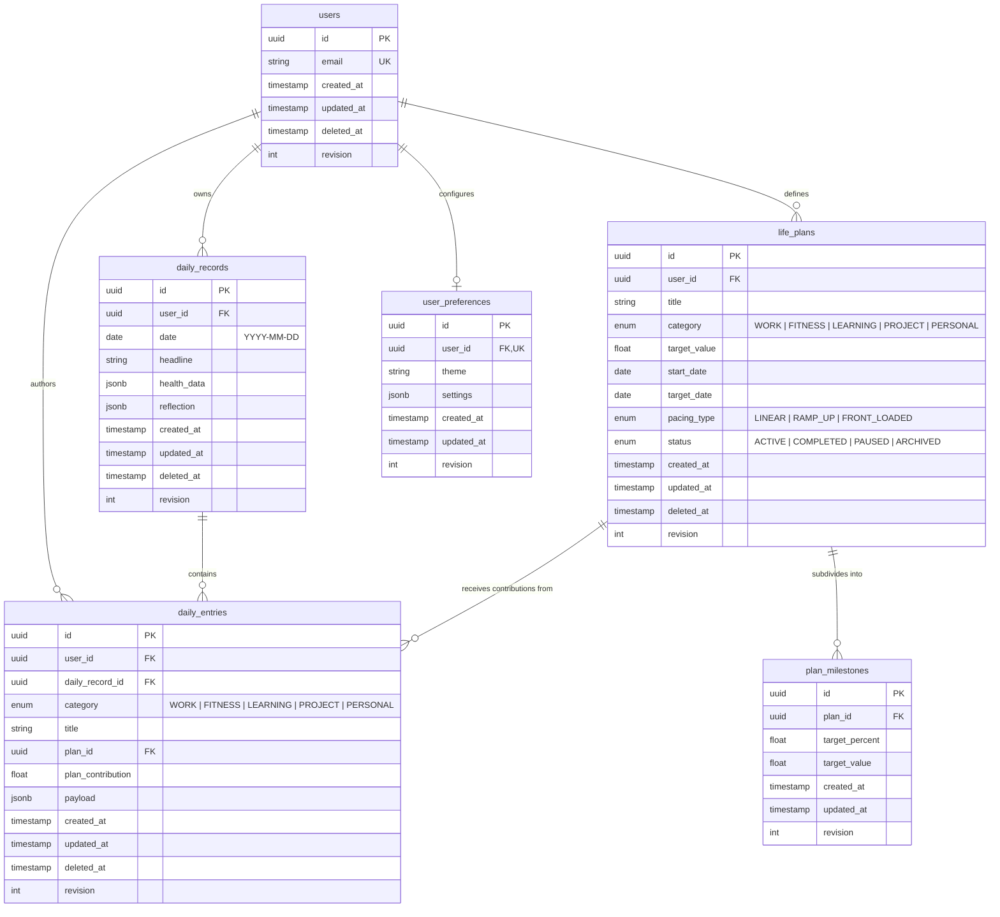

# Yester Database Design Specification

**Document Version:** 1.0.0  
**Target Engine:** PostgreSQL 16  
**ORM & Tooling:** Prisma ORM  
**Architecture:** Hybrid Relational Core + Validated JSONB Payloads  

---

## 1. Core Architectural Principles

Yester is a sovereign personal operating system and lifelong archive. Data stored in Yester may span decades of personal history, technical growth, fitness benchmarks, and multi-month life trajectories. 

The database architecture is governed by five non-negotiable principles:

1. **Strict Temporal Integrity (Calendar Date vs. Instant):** Daily journals are keyed by calendar dates (`YYYY-MM-DD`), not moments in time. Calendar dates use PostgreSQL `DATE` (`@db.Date`) without timezones. Timestamps (`DateTime` / `TIMESTAMPTZ`) are strictly reserved for audit points (`createdAt`, `updatedAt`, `deletedAt`).
2. **Single Source of Truth (Derived Metrics):** Aggregate progress metrics (`LifePlan.currentValue`) and milestone achievements (`PlanMilestone.isReached`) are dynamically derived from linked `DailyEntry` contributions (`WHERE planId = $planId AND deletedAt IS NULL`). They are never stored as independent unverified numbers that risk drifting upon edits or deletions.
3. **Universal Concurrency & Soft-Deletion:** Every independently editable entity implements `id` (UUID), `createdAt`, `updatedAt`, and `revision: Int @default(1)`. Soft-deletable entities include `deletedAt: DateTime?`.
4. **Atomic Optimistic Concurrency:** Revision increments are performed atomically during updates (`WHERE id = $id AND revision = $expectedRevision`, `SET revision = revision + 1`) to prevent silent overwrites in concurrent or offline sync scenarios.
5. **Multi-Entity Tenant Isolation:** A `DailyEntry`, its `DailyRecord`, and its linked `LifePlan` must strictly belong to the exact same user. This tenant boundary is enforced via composite constraints and transactional service validation.

---

## 2. Entity Relationship Diagram

---

## 3. Relational Tables Specification

### 3.1 `users`
Sovereign user account record.
* `id` (`UUID`, PK): Client- or server-generated UUID.
* `email` (`VARCHAR(255)`, UNIQUE): Primary lookup credential.
* `created_at` (`TIMESTAMPTZ`): Account creation instant.
* `updated_at` (`TIMESTAMPTZ`): Last profile modification.
* `deleted_at` (`TIMESTAMPTZ`, Nullable): Soft-delete tombstone.
* `revision` (`INTEGER`, Default 1): Concurrency counter.

### 3.2 `daily_records`
Daily record envelope representing a sovereign calendar day.
* `id` (`UUID`, PK): Client-generated UUID.
* `user_id` (`UUID`, FK -> `users.id` ON DELETE CASCADE).
* `date` (`DATE`): True calendar day without timezone offset.
* `headline` (`VARCHAR(255)`, Nullable): Day summary headline.
* `health_data` (`JSONB`, Nullable): Structured health metrics (sleep hours, water intake, habits checklist).
* `reflection` (`JSONB`, Nullable): Structured evening reflection (what went well, improvements, tomorrow's plan).
* `created_at`, `updated_at`, `deleted_at`, `revision`.
* **Constraints:** `UNIQUE(user_id, date)`. Ensures a user has exactly one record per calendar date.
* **Indexes:** `CREATE INDEX idx_daily_records_user_date ON daily_records(user_id, date);`

### 3.3 `daily_entries`
Granular, independently addressable activities and milestones logged within a day.
* `id` (`UUID`, PK): Client-generated UUID.
* `user_id` (`UUID`, FK -> `users.id` ON DELETE CASCADE).
* `daily_record_id` (`UUID`, FK -> `daily_records.id` ON DELETE CASCADE).
* `category` (`ENUM`): `WORK`, `FITNESS`, `LEARNING`, `PROJECT`, `PERSONAL`.
* `title` (`VARCHAR(255)`): Entry title / activity summary.
* `plan_id` (`UUID`, Nullable, FK -> `life_plans.id` ON DELETE SET NULL).
* `plan_contribution` (`DOUBLE PRECISION`, Nullable): Numeric contribution to linked plan (e.g., hours, reps, chapters).
* `payload` (`JSONB`): Category-specific dynamic fields (e.g., commit links, workout sets, book author).
* `created_at`, `updated_at`, `deleted_at`, `revision`.
* **Indexes:** `idx_daily_entries_user_cat` on `(user_id, category)`, `idx_daily_entries_record` on `(daily_record_id)`, `idx_daily_entries_plan` on `(plan_id)`.

### 3.4 `life_plans`
Long-term trajectory goals across multi-month spans.
* `id` (`UUID`, PK): Client-generated UUID.
* `user_id` (`UUID`, FK -> `users.id` ON DELETE CASCADE).
* `title` (`VARCHAR(255)`): Plan title.
* `category` (`ENUM`): Matching `ActivityCategory`.
* `target_value` (`DOUBLE PRECISION`): Target aggregate metric.
* `start_date` (`DATE`): Plan inception date.
* `target_date` (`DATE`): Target completion deadline.
* `pacing_type` (`ENUM`): `LINEAR`, `RAMP_UP`, `FRONT_LOADED`.
* `status` (`ENUM`): `ACTIVE`, `COMPLETED`, `PAUSED`, `ARCHIVED`.
* `created_at`, `updated_at`, `deleted_at`, `revision`.
* **Constraints:** `UNIQUE(id, user_id)`.
* **Indexes:** `idx_life_plans_user_status` on `(user_id, status)`.

### 3.5 `plan_milestones`
Intermediate evaluation points for life plans.
* `id` (`UUID`, PK): Client-generated UUID.
* `plan_id` (`UUID`, FK -> `life_plans.id` ON DELETE CASCADE).
* `target_percent` (`DOUBLE PRECISION`): Target progress percentage (e.g., 25%, 50%, 75%, 100%).
* `target_value` (`DOUBLE PRECISION`): Calculated target contribution milestone value.
* `created_at`, `updated_at`, `revision`.
* **Indexes:** `idx_plan_milestones_plan` on `(plan_id)`.

### 3.6 `user_preferences`
User-specific application configuration and UI layout.
* `id` (`UUID`, PK).
* `user_id` (`UUID`, UNIQUE, FK -> `users.id` ON DELETE CASCADE).
* `theme` (`VARCHAR(50)`, Default 'system').
* `settings` (`JSONB`): Key-value UI configuration.
* `created_at`, `updated_at`, `revision`.

---

## 4. Hybrid Relational + JSONB Strategy

| Data Type | Relational Column | JSONB Payload | Rationale |
| :--- | :---: | :---: | :--- |
| **User Identity & Auth** | Yes | No | Structured security, uniqueness, and relational integrity. |
| **Daily Record Envelope** | Yes | No | Key calendar date lookup and multi-entity child links. |
| **Daily Activity Entries** | Yes (Core) | Yes (Payload) | Core search/filter fields (`title`, `category`, `planId`) are relational; category attributes (workout sets, repo links) are in JSONB. |
| **Life Plans & Trajectories**| Yes | No | Mathematical trajectory computations require indexed numerical targets. |
| **Health Data (Habits)** | No | Yes | Dynamic daily habits change over time without requiring schema migrations. |
| **Evening Reflection** | No | Yes | Free-form editorial text fields (`wentWell`, `improvements`) bundled with record. |
